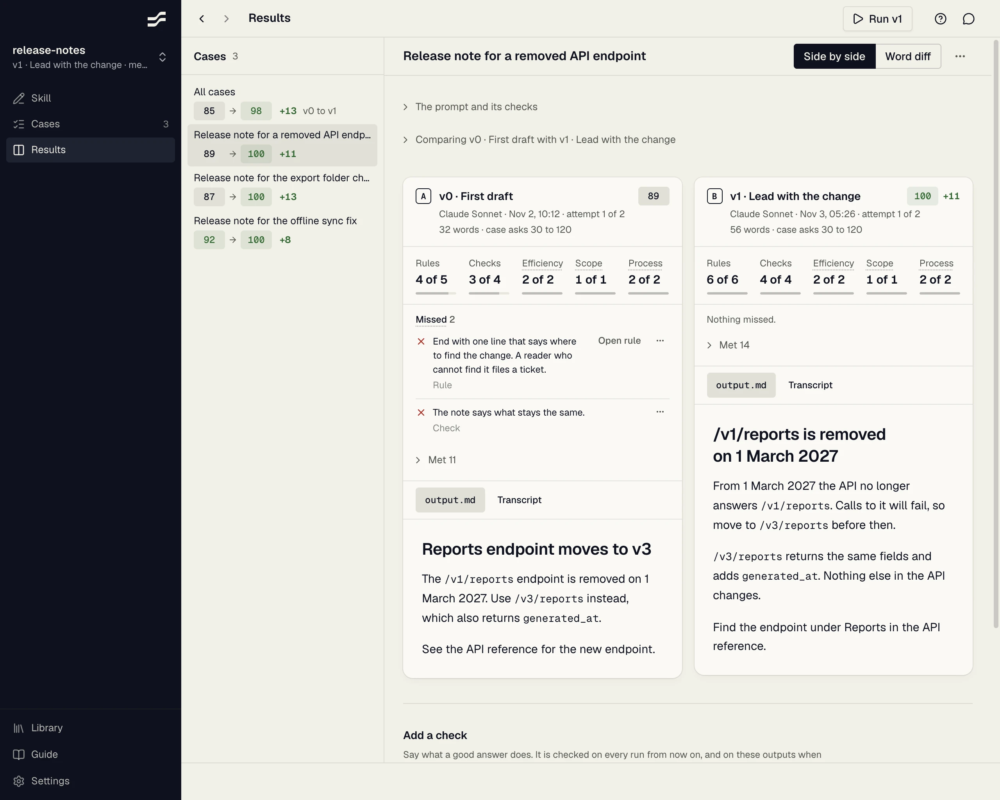

# Skill Studio

[](https://github.com/milesroxas/skill-studio/actions/workflows/ci.yml)

A desktop app for writing agent skills and seeing whether an edit made them better. You go round three steps:

1. **Write** the skill's rules.
2. **Run** an agent (Claude Code or Cursor) on a few test tasks, called cases, with the skill installed.
3. **Compare** each version's answers side by side, with what each one missed.

[TypeSafe](https://typesafe.ai)'s Jev grades every answer against your rules and each case's checks. A score counts the rules and checks met. Where you disagree with Jev, you mark the verdict and the score follows. Runs, scores and your corrections are plain files in the skill's `evals/` folder.

It suits work that is a matter of judgement, such as writing, web pages and agent process.



## Install

Download the newest version for your computer:

- **macOS, Apple silicon (M1 and later):** [skill-studio-mac-arm64.dmg](https://github.com/milesroxas/skill-studio/releases/latest/download/skill-studio-mac-arm64.dmg)
- **macOS, Intel:** [skill-studio-mac-x64.dmg](https://github.com/milesroxas/skill-studio/releases/latest/download/skill-studio-mac-x64.dmg)
- **Windows (64-bit):** [skill-studio-win-x64.exe](https://github.com/milesroxas/skill-studio/releases/latest/download/skill-studio-win-x64.exe)
- **Linux (x86-64):** [skill-studio-linux-x86_64.AppImage](https://github.com/milesroxas/skill-studio/releases/latest/download/skill-studio-linux-x86_64.AppImage)

On macOS, open the `.dmg` and drag Skill Studio to Applications. The Windows installer is not signed, so Windows may warn before it runs: choose **More info**, then **Run anyway**. On Linux, make the AppImage executable (`chmod +x skill-studio-linux-x86_64.AppImage`) and run it.

The app updates itself after that. Every version is on [Releases](https://github.com/milesroxas/skill-studio/releases), and [SECURITY.md](SECURITY.md#checking-a-download) says how to check a download.

You also need:

- The `claude` or `cursor-agent` CLI, installed and signed in. These agents write the outputs.
- A [TypeSafe](https://typesafe.ai) API key, added under Settings. Without it, no rule or check is marked.
- Optional, to write with AI: the `claude` or `codex` CLI signed in, or an Anthropic or OpenAI API key.

## Run from source

Needs Node 24 or later and pnpm.

```
pnpm install
pnpm dev        # the desktop app, with hot reloading
```

Keys can also come from the environment or a `.env` in the checkout ([.env.example](.env.example)).

## Get started

The first launch offers a walkthrough: a sample skill taken once round the loop. The [guide](docs/guide.md), also under Guide in the app, then covers each step for a skill of your own.

## Documentation

| Page | Covers |
| --- | --- |
| [Guide](docs/guide.md) | Using the app, step by step |
| [Skill and run files](docs/files.md) | What a skill, a case and a run hold on disk |
| [Grading](docs/grading.md) | The judge packs, `bench.json`, how scores are made, corrections |
| [Command line and web server](docs/cli.md) | The `st` command, `st serve` and the HTTP API |
| [Architecture](docs/architecture.md) | The layers, the desktop app, engines and the assistant |
| [Releasing](docs/releasing.md) | Cutting a release, signing and updates |
| [Release plan](docs/release-plan.md) | What goes into the next release, and what is done |
| [Hardening checklist](docs/hardening.md) | Known issues from the QA review, and which are fixed |
| [Changelog](CHANGELOG.md) | What changed in each release |

## Contributing

See [CONTRIBUTING.md](CONTRIBUTING.md). `pnpm check` runs the typecheck, Biome, fallow and the tests.

## Security

Skill Studio runs coding agents and executes the code they write. Read [SECURITY.md](SECURITY.md) before you run a skill you did not write.

## Privacy

The app has no account, analytics or crash reporting. [PRIVACY.md](PRIVACY.md) lists what it sends, to which service, and when.

## Acknowledgments

Skill Studio was made possible by Emil Kowalski's course [AI for Designers and Engineers](https://aiforui.dev). The course teaches designers and engineers to turn their taste into rules and skills an agent follows, and to review what comes back. Skill Studio's guide to writing a rule, and the way its own design docs are written for agents, come from what it teaches. If you want to write skills that hold your bar, take the course.

## License

[MIT](LICENSE). The license is the only terms for using Skill Studio. The services it calls (Anthropic, OpenAI, Cursor, TypeSafe, GitHub) apply their own terms to what you send them.

The MIT license covers the code. It does not cover the Skill Studio name or icon: a fork or a product built on this code must use a name and an icon of its own.

The app ships the licenses of the open-source code it includes in its resources folder, as `THIRD-PARTY-LICENSES.txt`.
