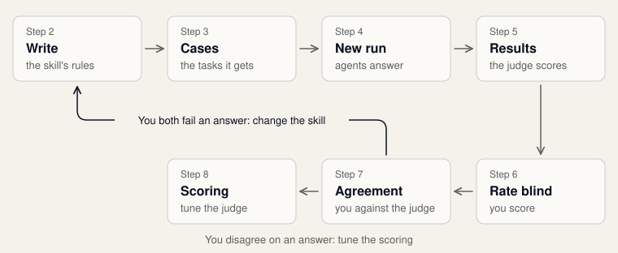
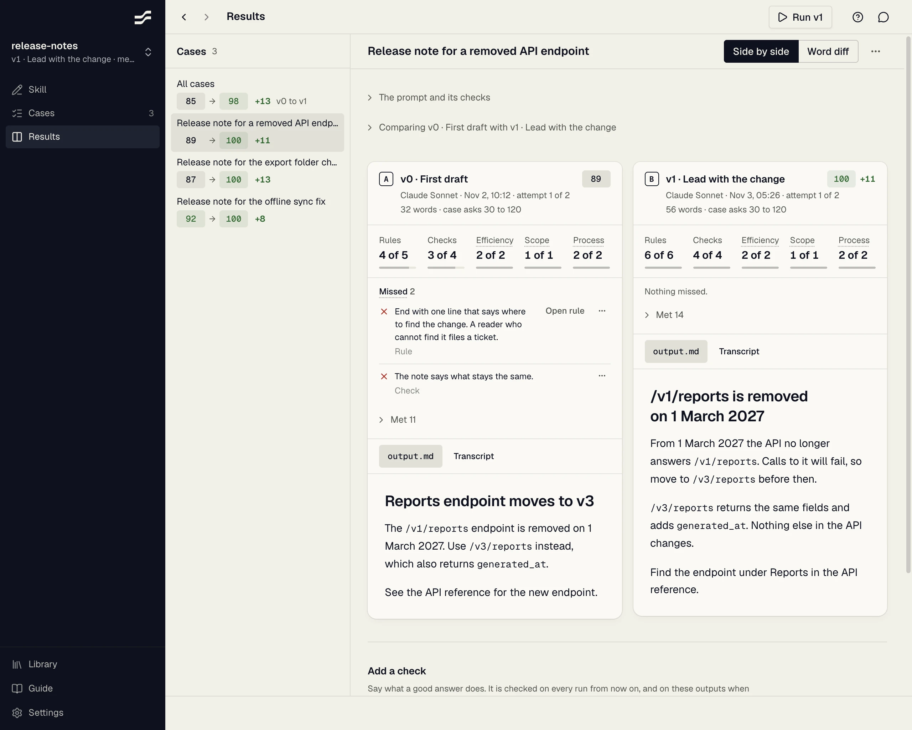
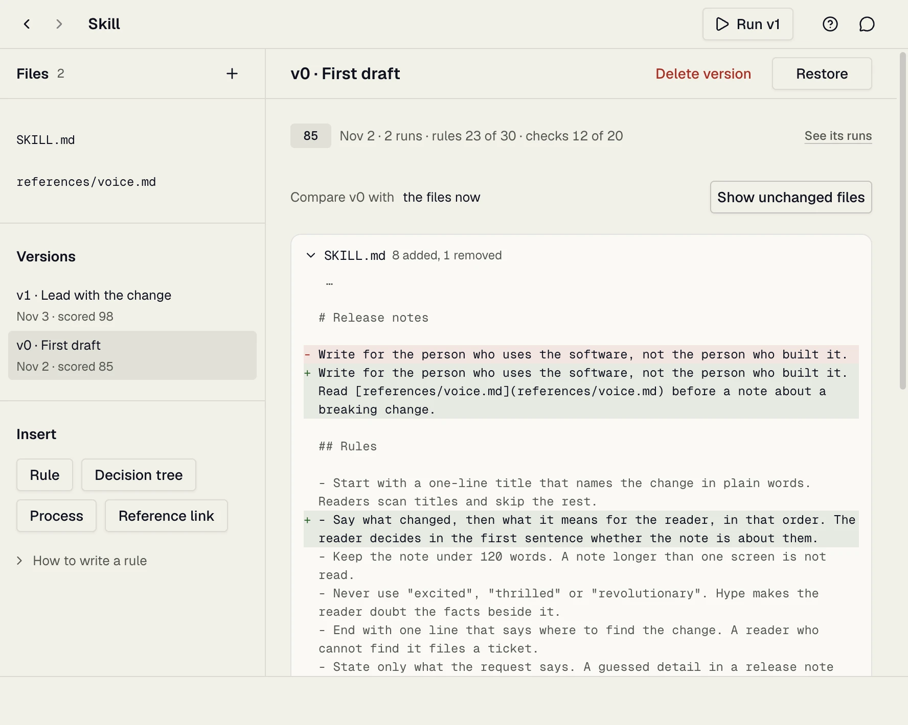
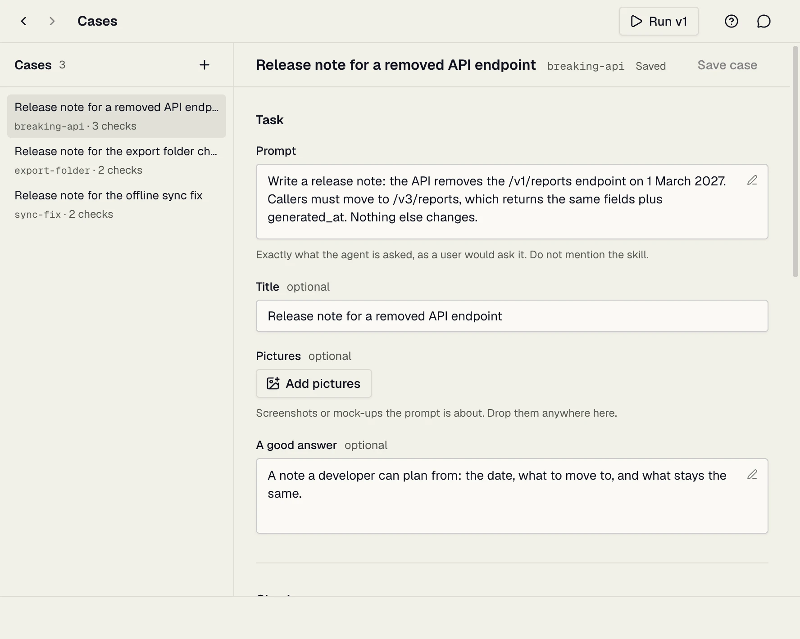
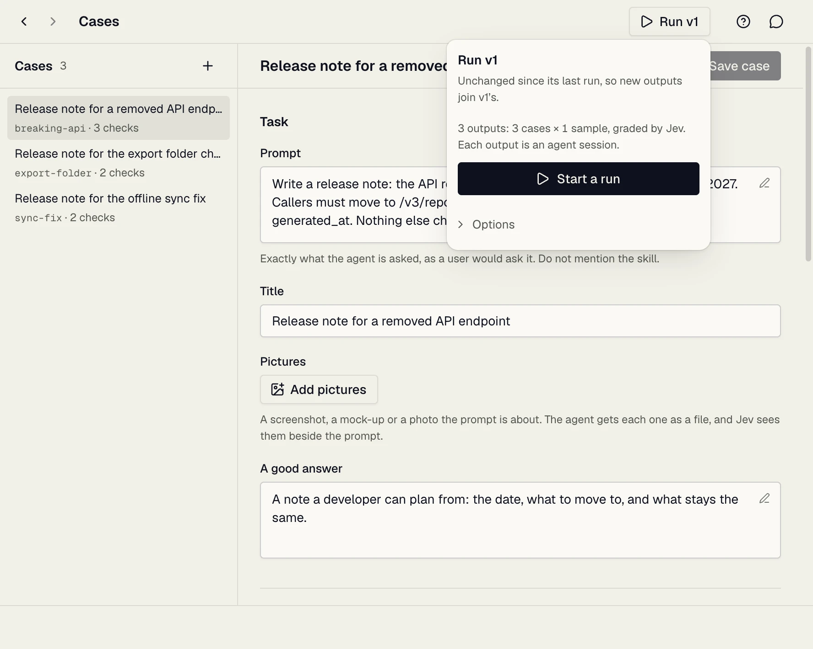
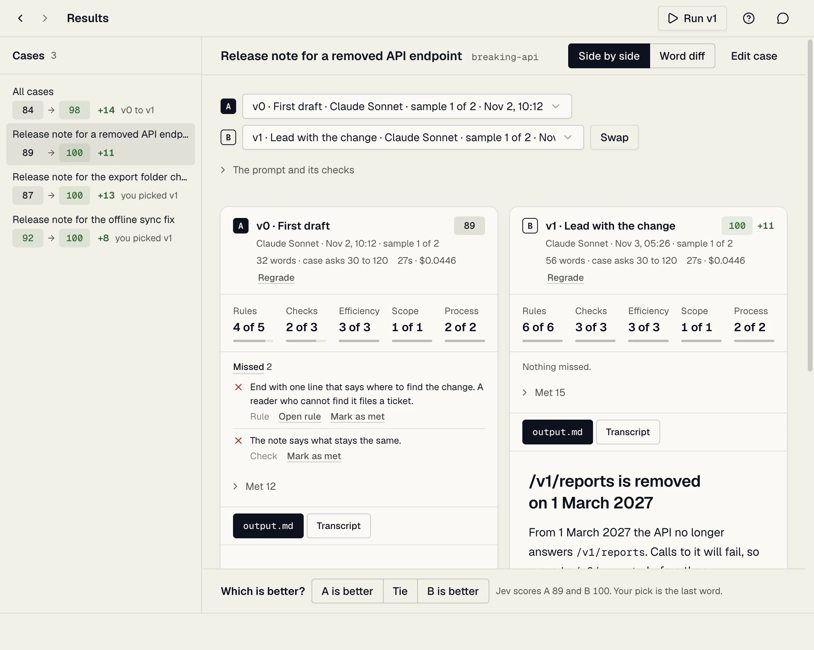
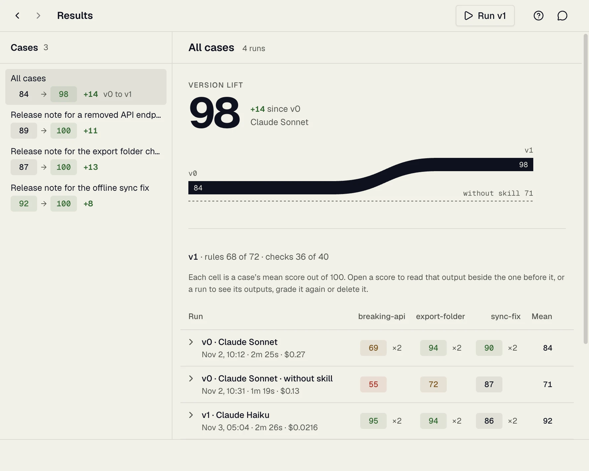

# How to use Skill Studio

Skill Studio helps you write a skill for an AI agent, and shows you whether your last edit made its answers better.

## How the loop works



| Step | Where | You |
| --- | --- | --- |
| 1. Write | Skill | Write the skill's rules, or change one |
| 2. Run | The Run button | Have an agent do the skill's cases |
| 3. Compare | Results | Read the new output beside the last one, and see what it missed |

Then you go round again. Cases are the tasks a run is made of. You write them once on the Cases screen and add to them as you learn what to check.



The pictures show a sample skill, release-notes. Its scores are made up.

### Finding your way

- **Sidebar:** the three screens of the open skill. The number beside Cases counts them. A dot means unsaved work.
- **Run** (top right, with the version it tests, such as **Run v1**): has an agent do the cases. It shows once the skill has a case, and is yellow when running is the step to do now. Before the first run it reads **Run without skill**: a run with no skill at all, the score your skill has to beat. To skip it, open it and click **Test the skill instead**.
- **Next** (top right, yellow): the step to do now, when it is on another screen. After a run, it is **Read the results** until you open Results.
- **Switch skill:** click the skill's name at the top of the sidebar, or press Cmd+K.
- **Library, Guide and Settings:** at the foot of the sidebar. A run's progress shows there too.
- **Back and forward:** the arrows at the top left.
- **Help:** the question mark at the top right explains the screen you are on.
- **Dotted underline:** click the word to see what it means.

On Windows and Linux, press Ctrl where this guide says Cmd.

### Who decides what is good

You do. You say what good is in writing: the **rules** of the skill and the **checks** of each case.

**Jev** is an AI model that reads every output against those rules and checks, the same way each time. It answers facts: was this rule followed, was this check met. A score is a count of those facts.

When you read an output differently, you change the facts, not the score: mark the one verdict Jev got wrong, or write down what it did not check. "When you and Jev disagree", under step 5, says how.

## Start the app

You need:

1. **Skill Studio.** Download it from [Releases](https://github.com/milesroxas/skill-studio/releases).
2. **Claude Code or Cursor**, installed and signed in. These agents write the outputs.
3. **A TypeSafe key** from [typesafe.ai](https://typesafe.ai), for Jev. Without it, outputs get basic automatic checks only: no rule and no check is marked.

The first time you open the app, a welcome offers two ways in:

- **Try it on a sample skill** opens the walkthrough below. It teaches the loop by doing it.
- **See how it works** shows the loop in three steps first, then leads to the same sample skill.

If the Jev key is missing, one step asks for it on the way. Not now? Click **Configure later**. The folders your skills live in are added in the Library, and a model for **Write with AI** in Settings, when you first need them.

To see the welcome again, click the question mark, then "How Skill Studio works".

To add the Jev key later, open **Settings** at the foot of the sidebar. Until you do, a "No Jev key" label at the top right takes you there. Settings also holds the theme and your other preferences.

## Take the walkthrough first

Take a finished skill once round the loop. Click **Try it on a sample skill** in the welcome, or **Start the walkthrough** in the Library before your first run. Until you take it, the New skill form also has a **Take the walkthrough** link.

The walkthrough's skill, Thank-you note, writes short thank-you notes, so a run takes a minute or two. Nothing needs typing. It opens on the Skill screen, with its rules in view. The Walkthrough box in the sidebar shows your step, and clicking it takes you there. The yellow button at the top right is the way on:

1. **Run the skill.** Click **Run** at the top right, then **Run 3 cases**. An agent writes a note for each of the three cases.
2. **Read what the notes missed.** Results shows each note with its score, and under it the rules and checks it missed. Without a Jev key a note has no score, and only its length is checked.
3. **Tighten one rule.** "Keep the note to a reasonable length" is vague on purpose, so the notes come back too long. Once you have read the results, the Skill screen offers the exact rule: click "Use the exact rule", then Save.
4. **Run it again, then compare.** Only the rule changed, so any difference is your edit. Once the run is in, read a note from each version side by side.

Reading what the notes missed and comparing are done once you open Results for them. The box keeps to that step while you read, and the yellow button leads to the one after it. While the walkthrough runs, its box is the only guide on screen: each screen's own first-visit line waits for a skill of your own.

The walkthrough never changes what your agents do. To start over, open the skill menu at the top of the sidebar (Cmd+K) and choose **Restart walkthrough…**.

## 1. Open or create a skill


- **Open a skill:** click its name. Type in the search box to find one.
- **In progress:** the skills you opened here, or gave cases or runs. Every other skill is under **Other skills**, so each one is listed once.
- **Mark done:** moves a skill from In progress to Other skills. Undo on the status line takes it back. Saving SKILL.md, adding or changing a case, or running it puts it back in In progress; opening it does not.
- **Claude, Cursor, Codex:** install the skill for that agent, or remove it. Removing never deletes the skill.
- **"copy" on a button:** that agent has its own copy. Your edits here do not reach it.
- **A source under the place,** such as `someone/skills`: a tool installed the skill from there. Updating it with that tool replaces the folder, and your edits with it. The Skill screen says so too.
- **Folder icon:** shows the skill's files on your computer.
- **The … button** stands in for a row's actions when the window is narrow: Mark done and the folder action are in its menu.

To make a new skill:

1. Click **New skill**, or press Cmd+K, type the name and press Return. When no skill matches, the New skill form opens with that name filled in; otherwise Return opens the skill that matches.
2. Type a name in lowercase, with dashes, like release-notes.
3. Write one line on what it is for. Agents read this to decide when to use it. Left empty, the Skill screen asks for it.
4. Pick a template: Blank, or a kind of skill with example rules to replace. For a kind of skill, leave "Add 3 sample cases to run against" ticked.
5. **Where it lives** says the folder and the agents that get it: your home, for Claude Code. Open "Change the place or the agents" to pick a project or other agents.
6. Click **Create skill**, or press Return.

A skill missing from the list?

- Choose **Every place** in the place filter, and clear the search box.
- Click the round arrow beside New skill to look again.
- Open "Where skills are found" at the bottom, and add the folder its project is in.

## 2. Write the skill


- **Write** the skill's rules in the editor. Save with **Save** or Cmd+S.
- **An empty SKILL.md** has one line over it: write the first rule, take a template's rules, or draft rules with AI. It goes once you write.
- **Rules are numbered.** Each bullet Jev will check shows its number in place of the bullet, 01, 02. A bullet that keeps its dot is skipped; point at it for why. An amber number means the writing checks found something: the words that set a check off are underlined, and clicking the number selects the rule: the popout lists what the checks found over Auto refine, Suggest changes and Help me improve. Resting the pointer on an underlined word opens the same popout, with what that word set off, without selecting anything. From the keyboard, F6 moves into the popout and Escape returns to the text.
- **Insert** adds a ready-made rule, decision tree, process or reference link at the cursor.
- **Formatted, Markdown, Changes:** read the page styled, as plain text, or as your unsaved changes.
- **Five bars** (before Write with AI, at the end of the toolbar) show the file's size. Amber: getting long. Red: too long.
- **Long background material** goes in a file of its own: click the plus beside Files. **Delete file**, beside the name of a saved reference file, removes it.

Unsaved text is kept, even if you close the app. **Discard** throws it away.

### What Jev checks

Jev checks every bullet that starts a line and has four words or more. It skips:

- Numbered lists. Use them for steps.
- Sentences inside a paragraph.
- Indented bullets. They count as part of the bullet above.
- Bullets inside a code block.
- A bullet that is only a link.

### How to write a good rule

- **Name the action, not the result.** "Open with what changed for the reader", not "write clearly".
- **Give the reason in the same bullet.** It tells the agent where the rule stops. Jev grades one bullet at a time.
- **Make it checkable.** A count, a limit, or always, never or only.
- **Cut what the agent would do anyway.** Definitions and reminders to be correct change nothing.
- **One skill, one job.** Rules for another job crowd out the ones this skill is for.
- **Prove it with a case.** Change one rule, run the cases, compare the scores.

```
Leaves the agent to guess:
- Release notes should be clear and not too long.

Says what to do, and why:
- Open each note with what changed for the user, in one sentence. Most readers stop after the first line.
```

This approach to rules comes from Emil Kowalski's course [AI for Designers and Engineers](https://aiforui.dev), which teaches how to turn your taste into rules and skills an agent follows. Skill Studio was made possible by it.

### Write with AI

- **Connect a model** in Settings. Claude Code and Codex are the main way: they run on the account you already use, with no key. An API key works too, under **Use an API key**. Settings says whether Claude Code and Codex are installed and signed in. When one is not, it shows the command to run in Terminal (`claude auth login`, or `codex login`), with **Copy command**. Run it, come back, and Settings shows the account and the plan.
- **Pick the model** in Settings, or from the model's name in the Assistant. Models are listed under who runs them, such as Claude Code or Codex, and the model you picked always shows its provider beside its name.
- **Ask:** click the small button in any text box, or **Write with AI** in the editor toolbar. Say what you want.
- **Nothing changes** until you click **Replace** or **Insert** (**Add**, for checks).
- **Closing the box keeps the reply.** A reply being written goes on, and opening the box again on the same text finds it. Only **Discard** throws it away. Opening it on other text, or with another selection, starts afresh.
- **Select text first** to rewrite only that part.
- **Assistant** (top right, or Cmd+J): a chat beside every screen. It reads the open skill as you have it, unsaved edits and new files included, and knows the screen you are on and the file or case you have open. Ask it to change something and the reply shows each change under it: a file's changes, a new case, or a version to keep first. A case it adds or replaces can mark a check ×2: ask for it. Click the button at the end of a change's row to apply it. For a file change or a new case, Undo in the status line takes it back; a replaced case or a kept version offers **Open** instead. Nothing changes until you click. **New conversation** in the panel's header starts over.
- **Commands in the Assistant:** type `/` and pick from the list, or keep typing a name; Tab takes the one shown. `/clear` starts a new conversation, `/settings` and `/guide` open those screens. While a reply is written, the send button becomes Stop.
- **Run a skill in the Assistant:** with Claude Code as the model, the same list holds the skills your CLI knows. Pick one, add any words it takes and press Return. The skill shapes the reply the way it would in your terminal, and still nothing in your files changes.

### Improve a selected rule

Select four or more words in SKILL.md and a small bar appears over them with three choices. The whole line is taken, since a rule is a line. Nothing changes until you click a result.

- **Auto refine** checks the rule against the guide above, how many conditions it holds, and how long it and the file are. If something drifts, you see what and a revision to **Replace**. If nothing does, it says so and offers Help me improve instead.
- **Suggest changes** writes three rewrites, always in this order: **Best practice** fixes what the checks found, **More direct** puts the constraint first in the imperative, **Shorter** keeps the rule in fewer words. Click one, or press 1, 2 or 3, to put it in place. The new text is tinted for a moment, and the status line offers **Undo**. When Jev reads a rewrite as dropping a fact of the selection, the card says "May drop a fact": read it before you pick, but the pick is yours. **Try again** asks for three more.
- **Help me improve** opens the Assistant on this rule and waits for you. The top of the message box names the rule you are working on, such as Rule 04; click it to bring the rule into view in the editor. Say what should change, and you get a draft: a suggestion, which changes nothing until you apply it. When the draft guessed at something only you know, or one more change seems worth trying, the reply says so in a sentence; otherwise it leaves the next step to you. Or press **Ask me a few questions** to answer a short set first: what the agent does differently, whether it is a step or a quality, where the line is, why the rule exists. A draft shows as a change to SKILL.md: the rule with old phrases struck through and new ones marked, its length in words and, with a Jev key, whether it meets the guide. **Apply** puts it in the file, with **Undo** on the status line, and the conversation stays open: ask why, ask for another change, and apply again. Any earlier draft can be applied again to go back to it. While the conversation is open, the rule in the editor keeps a bar down its left edge and a light tint. The arrow at the top goes back to the chat; it asks first, since the conversation is not kept.

With a TypeSafe key, Jev reads the rule and the answers, so the checks are exact and the same whatever model writes the text. Without one, only the word and count checks run.

### Versions



A version is a copy of the skill as it was for a run, named v0, v1 and so on. You never save one by hand: when the files changed since the last run, the next run keeps them as the next version. Every score stays tied to the version that produced it.

- **Versions**, under Files, lists them, newest first, each with its date and score. After a **Restore**, the version the files match says *in the files now*.
- **Click one** to see what changed between it and the files now, file by file. Pick the version before it instead, such as **v1, the version before**, to see what that version itself changed.
- **Restore** puts a version's files back. If the files changed since the last run, they are kept nowhere else: run them first to keep them.
- **Delete version** deletes it and its runs. **Undo** brings them back. To delete one run and keep the version, use **Delete run** on Results: under the run on All cases, or under **More actions** (⋯) on a case.

## 3. Write cases

A case is one task for the agent: a request, and what a good answer does.



Start with the prompt alone. It is enough to run the case, and reading what the agent wrote shows you what to check.

1. Click the plus above the list. A new case shows the task alone: a title, the prompt and files.
2. **Title** (optional): a short name for the lists. Left empty, the case is named after the first words of its prompt. No two cases can have the same title.
3. **Prompt:** what a user would ask. Do not mention the skill: the test is whether the agent uses it on its own. To start from a finished case instead, open **Start from an example** under the prompt and click **Use** on one. A skill graded on its rules and checks alone picks the kind of skill first.
4. **Files** (optional): any file your prompt refers to, such as a screenshot, a document or code. **Add files** picks files and **Add folder** picks a whole folder, or drop them anywhere on the case. A file that is not added cannot be read when the case runs: What the agent sees, below, says why.
5. Click **Add case**. The rest can wait until you have read an output.

The line under the files folds the rest of the case and names what it holds, such as **A good answer, checks and length**. Click it to open or close it. It is open whenever one of these holds something, as on a case started from an example, and closed while all are empty, before saving and after:

- **A good answer** (optional): one or two sentences on what it does.
- **Checks** (optional): one fact per row that a good answer makes true. Return starts the next row; Backspace on an empty row removes it. The picture button in a check's corner attaches a mock-up or screenshot the check is about. **×2** makes a check count double. **Write checks with AI** adds checks from the prompt.
- **Length** (optional): tick it to score the word count, then set the fewest and the most words.
- **Size** (optional, in one section with Length, for a skill graded as Design, or a case that already has one): tick it and set a width and a height in pixels. A picture must be exactly that size, and one that is not is listed under Missed, as a word count outside the range is. A page is drawn at that size when Jev looks at it, and opens at that size on Results. **Check that a page works on a phone too** has Jev also look at the page 390 px wide. Leave it off for a page made for a desktop window.

### What the agent sees

A run does not happen in your project. Each case starts in a new, empty folder that holds a copy of the skill, the prompt and the case's pictures and files, and nothing else. The agent is told not to read outside that folder, use MCP tools or reach the network. So when a prompt is about something of yours, such as a screen's code, a design file or a document, give the case a copy:

- Add it under Files, with **Add files** or **Add folder**, or drop it on the case. What you add is copied into the case when you save it.
- A picture added on its own, such as a screenshot or mock-up, shows in the list with its thumbnail. Jev sees it too. A case holds 6 of these at most. A picture inside a folder you add is a file like the rest of the folder.
- A folder keeps its layout and leaves out hidden files and `node_modules`. You can add 500 files and 16 MB at a time, so add only the folder the prompt is about, not the whole project.
- To bring a copy up to date, add it again: one with the same name takes its place. **×** takes one off when you save.
- **Reveal in Finder** (**Show in File Explorer** on Windows, **Open containing folder** on Linux), at the end of the Files label on a saved case, opens the case's `files` folder, to change what is there by hand. The form lists it when you come back to the window.

A check such as "the colors come from the project" can only pass when the project's colors are among the case's files.

To change a case, click it in the list, edit it and click **Save case** (Cmd+S). **Delete case**, at the foot of the form, removes it. Past runs keep their outputs.

To try a variation on a case, click **Duplicate** at the top of a saved case. The copy has everything the case has, its checks, pictures and files too, and opens under the case's title with "copy" after it, and a number after that when another case has that title. Duplicate shows while the case has no unsaved changes: save or discard them first.

Checks can come later: on Results, **Add a check** turns what an output got wrong into one.

A check is marked on everything the run made: the file, how a page or a picture looks, any other files beside it, and what was said about it. So "The answer says which size it used" can pass on what was said, and "The page has one button" on the page.

Write at least three different cases before you trust a score.

## 4. Run it



1. Click **Run** at the top right. A panel opens and says what the run tests, and whether it saves the skill as a new version.
2. If the skill changed since its last run, the run keeps it as a new version. Type what changed under **What changed**, or leave it: the version is then named after the date.
3. Click the button that names the run: **Run 3 cases**, or **Run 3 cases, 2 attempts each**. The line under it says which agent answers the cases and that Jev grades the results.

A run tests the files as saved. When a file has unsaved edits, the panel says so: save it on the Skill screen first. Without a Jev key it says that too: no rule or check is marked in the run.

The defaults suit most runs: every case, once, with the agent you used last. **Options** changes them:

- **Cases:** untick the ones to leave out.
- **Skill:** "This version", "No skill" (the baseline to beat), or "An earlier version" (to run an old copy of the skill again: pick it under **Version**, which starts on the newest run's copy, the version before your edits).
- **Agent, Model, Effort:** who writes the outputs. Pick a model from the list or type its name. An agent that is not set up says how to set it up under **Agent**.
- **Attempts per case:** use 2 or more to see how steady the skill is. Agents answer a little differently each time, and each attempt shows on Results.

The run works in the background. Its progress shows at the foot of the sidebar: click it for the log, where **Stop** ends the run. Jev grades the outputs when they are written.

Runs cost money: each output is an agent session, and Jev is paid per call.

## 5. Compare the results



Results opens on a case with two outputs to compare: **A**, the version before, and **B**, the latest. With one version, A is the output written without the skill, if you ran one.

- **Scores**, the list on the left, has every case that was run, with how its score moved. Click one to compare it.
- **Each output** has its version and its score out of 100. Click the version to read another output of the case on that side: each is listed with who wrote it and when. Under the version, a line names what tells the two outputs apart besides their version, such as the agent that wrote each when they differ.
- **Click the score** to see what it is counted from, "Rules 4 of 5", "Checks 2 of 3", and how the output was made: who wrote it, when, which attempt, and its length against what the case asks. A check marked ×2 counts two. A part with a dotted line, such as **Look** or **Process**, comes from a kind of work under **Graded as**, below: click it to read what it grades, and **Change what is graded** to turn it off.
- **Missed** lists each rule from your skill that the output broke, each check it did not meet and, for a page or a picture, each flaw in how it looks. Every output is graded on the skill's rules, the one written without the skill too: there, a miss shows what the skill adds. **Open rule**, beside each rule, takes you to that rule on the Skill screen.
- **Met** folds the rest away. Open it to read them.
- **Read the transcript**, under the output, shows every step the agent took in its place. Read it when a score surprises you. Did the agent read the skill at all? **Back to the output** returns.
- **A page or a picture** opens on a stage above the scores, drawn as a browser draws it, scripts and all. **A** and **B** over the stage, each with its version and its score, or the A and B keys, put either output in the same place, so flipping shows exactly what changed, and each page keeps its place as you scroll. The menu beside A and B picks another file the output wrote, by name, or **Transcript**. A component that does not open in a browser by itself, such as a React component, shows through `outputs/preview.html`, a page the run asks the agent to write beside it.
- **The line under the stage** names the size a page is drawn at, then how far it is scaled down to fit, or under Full width how many pixels wide it is. Click the name to change it: **Full width**, **Phone**, **Tablet** or **Desktop**. A case with a size adds **Case size**, opens at it, and shows the whole page at that size. **Open full size** opens the file in a window of its own. A page in a card, under Side by side, has the same line over it and is scaled down to fit the card.
- **One at a time**, **Side by side** and **Word diff**, at the top right, show with two outputs, One at a time only when one of them wrote a page or a picture. One at a time is the stage. Side by side shows the two as cards, with each file and the transcript. Word diff marks what differs between them, and two outputs of code open on it. Outputs too long to compare word by word are compared line by line, and the card says so.
- **Reading v1 alone**, above the output when one side is empty, and **Comparing v0 with v1** under Word diff, name the pair. Open it to pick outputs for **A** and **B**, or to **Swap** their sides.
- **More actions** (⋯), at the top right, holds **Edit case**, **Swap A and B**, and a regrade for each run the outputs came from: **Regrade A’s run** and **Regrade B’s run**, or **Regrade this run** when there is one. Jev reads that whole run again, for example after you add a check. An output not graded yet shows **Grade** on its card. Last in the menu, in red, **Delete this run** (or **Delete A’s run**, **Delete B’s run**) deletes the whole run, on every case, not only the output you are reading.

### When you and Jev disagree

You may read an output differently from Jev: prefer the side that scores lower, or see a miss Jev did not. Each disagreement means one of three things, and each has a fix that changes the score:

| You see | It means | Do |
| --- | --- | --- |
| Jev passes an output you do not like | Something you care about is not written down | Add a check, below, or add a rule to the skill |
| Jev fails an output you like | A rule or a check asks for the wrong thing | Edit or delete it |
| Jev misread one rule or check | That verdict is wrong | Open **More actions** (⋯) beside it and click **Mark as met** or **Mark as missed** |

A verdict you mark is yours from then on. It moves to the other list with "your answer" beside it, the score follows, and **Take back**, in the same menu, lets Jev's answer stand again. If a threshold set in `bench.json` later brings Jev round to your answer, the row says so and stays yours.

### Add a check

Under the two outputs, **Add a check** takes one sentence: what a good answer does that one of these does not. It joins the case's checks. Jev marks it on every run from then on, and on the outputs in front of you once you click **Regrade**.

### All cases



**All cases**, at the top of the list, shows every case and every run at once.

- **Top:** how much your latest version gained since the first, and against no skill at all. Under it, the latest version's rules followed and checks met, added up.
- **Scores:** one row per case, by its title, and one column per run, headed by its version and model, oldest first. A run without the skill is headed **Without skill** and comes last: it is the score to beat. The lists that pick an output on a case set it apart the same way, under **Without the skill**.
- **A cell with no score says why.** **Not graded** opens the output, which has no score yet. **Not run** means the run left the case out, and **Writing…** and **Grading…** mean it is still being done; those open nothing. A score that comes in while you watch rises into its cell.
- **Click a score** to read that output beside the one before it.
- **Runs**, under the scores: one row per run, with its average. Under its name: when it ran, how long it took and what it cost.
- **Click a run** to see each output with what it missed. **Changes since this run** shows what changed in the skill after it. A run without the skill has none, since it used no skill. **Regrade** has Jev read the run again.
- **Delete run**, under the run, deletes that run's outputs and your corrections on them. Every score stops counting it, here, on each case and in the version list. Its version stays: when the run was the version's only copy, the version is saved from it first. **Undo** on the status line brings the run back. A run still writing or being graded can be deleted once that ends.

To be sure an edit helped, run with **Attempts per case** at 2 or more. If two versions' scores differ less than one version's attempts do, the edit made no clear difference.

### Graded as

Most skills never need this. Every skill is graded on its rules and its cases' checks, whatever it makes: text, a page, a picture or code. Nothing else is graded unless you ask. The line folded at the foot of All cases, **Graded on rules and checks**, opens the kinds of work, each of which adds more to grade. Once one is ticked, the line names it, such as **Graded as Design**:

- **Design** looks at a page or a picture: one clear main point, and nothing broken. It checks nothing a rule of yours did not ask for.
- **Workflow** grades how the work was done: repeated steps, staying in its own folder, and what came after an error.
- **Code** runs the check command a case names in its `case.yaml`.

Click **Save**, and every score updates at once. Nothing runs again, so it costs nothing. A kind ticked after a run counts on that run once you **Regrade** it.

The points each part counts, the threshold at which Jev's answer counts as met, and a kind's own settings are set by hand in `evals/bench.json`. When the file sets any of them, Graded as names them, and saving keeps them as they are.

### Then change the skill

1. Read what the outputs missed.
2. Fix what the weak outputs have in common, not one output.
3. Run again, and compare.

## When something goes wrong

| Problem | Fix |
| --- | --- |
| "No Jev key" at the top right | Add the key in Settings |
| An agent says "(not set up)" under Run, Options | Install that agent and sign in to it |
| A skill is missing from the Library | Choose Every place, click the round arrow, or add its folder under "Where skills are found" |
| Save is greyed and a notice says the file or case was changed outside the app | It changed outside the app after your draft began. "Keep my edits", then Save, writes yours over it; "Take the changed file" or "Take the changed case" keeps the other |
| A bullet keeps its dot and gets no number | Make it a bullet of four words or more, outside a numbered list, and not only a link |
| The agent says it cannot find your project, a screen or a file the prompt names | A run sees only the skill, the prompt and the case's input files. Open the case and add what it needs with **Add files** or **Add folder**, under Files |
| A score looks wrong | Read the transcript, then mark the verdict that is wrong |
| Results shows one output, not two | The case has one version and no run without the skill. Edit the skill and run again, or run with "No skill" under Options |

Only test skills you trust. A skill can make the agent run code on your computer.
