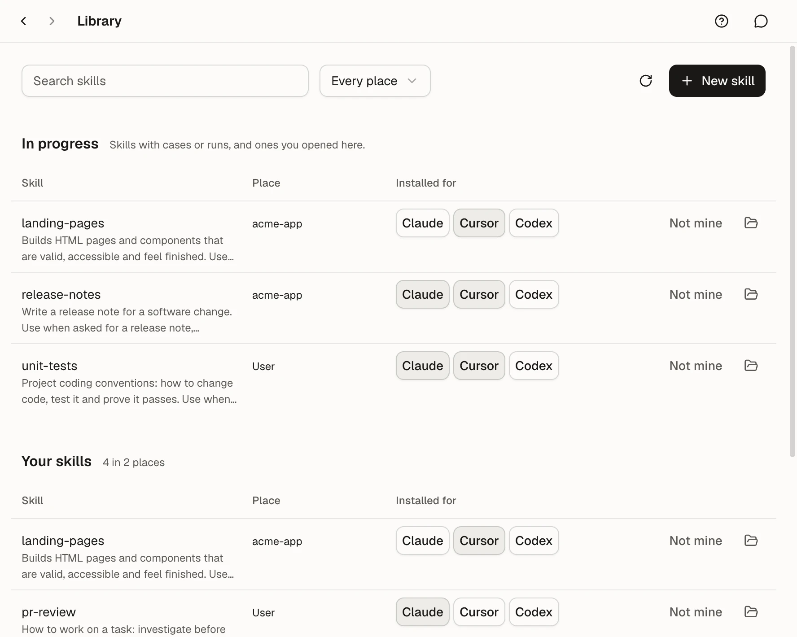
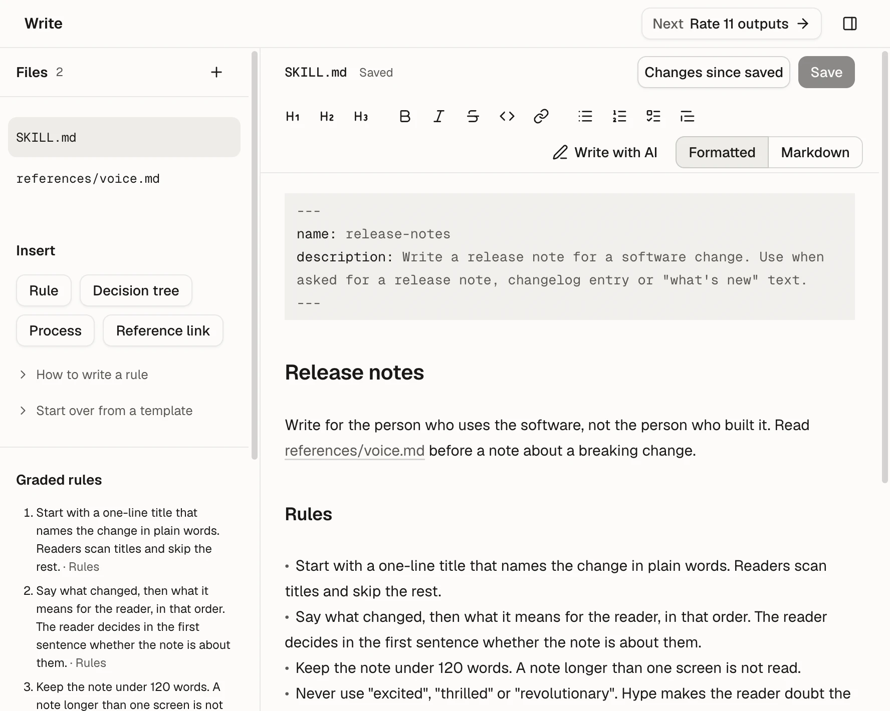
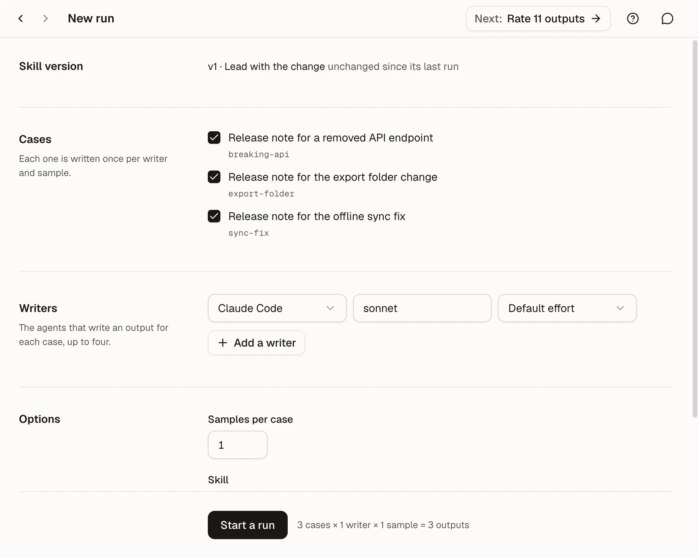
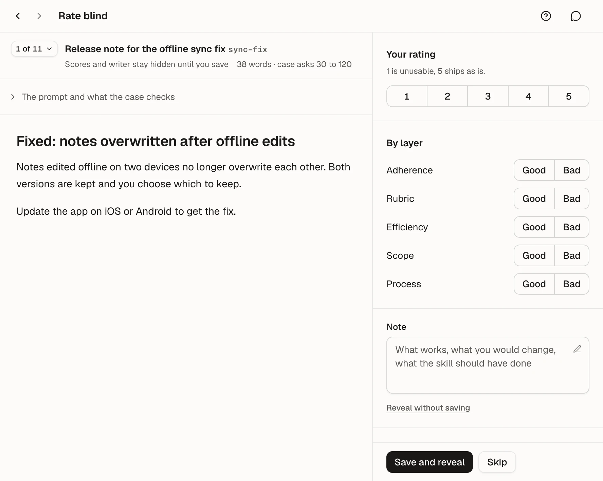
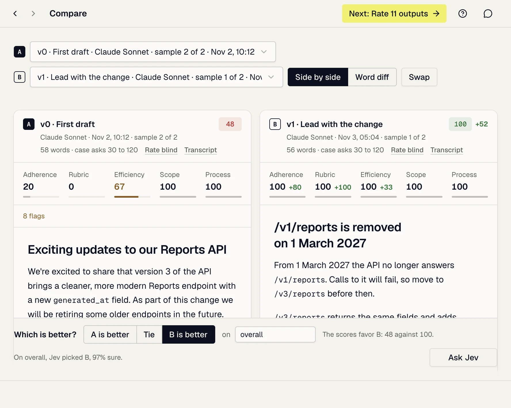
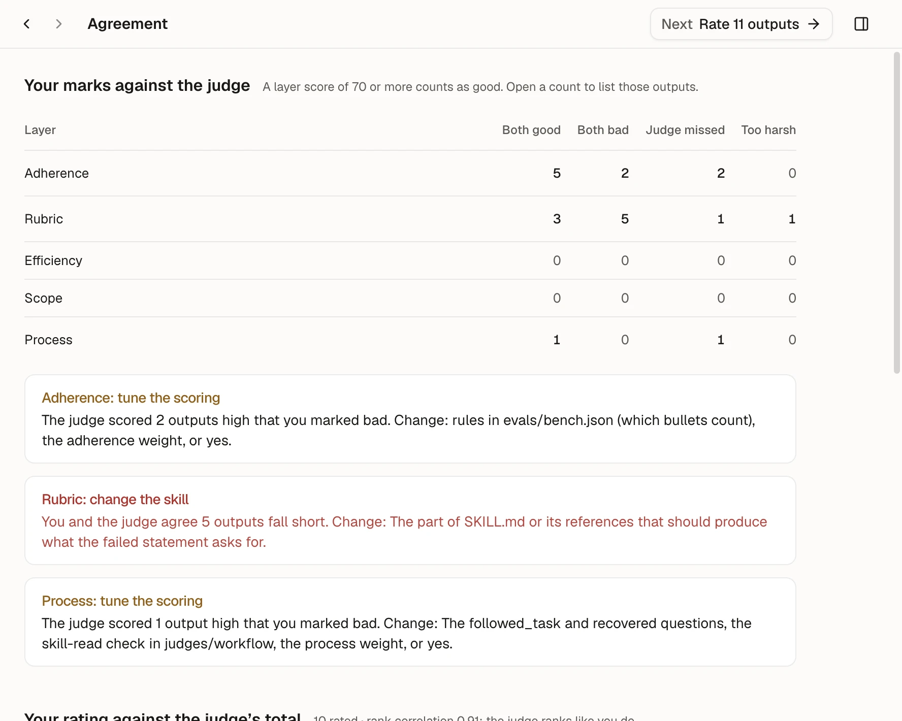
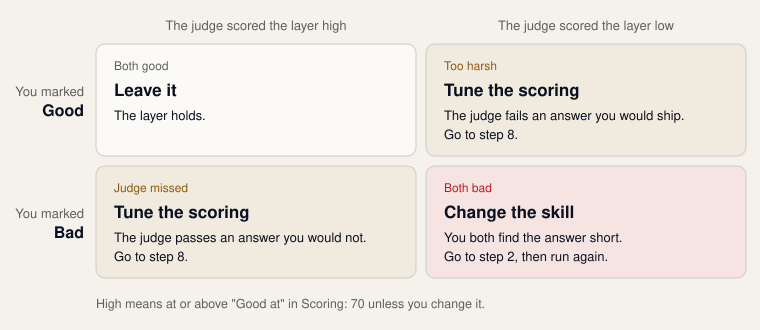
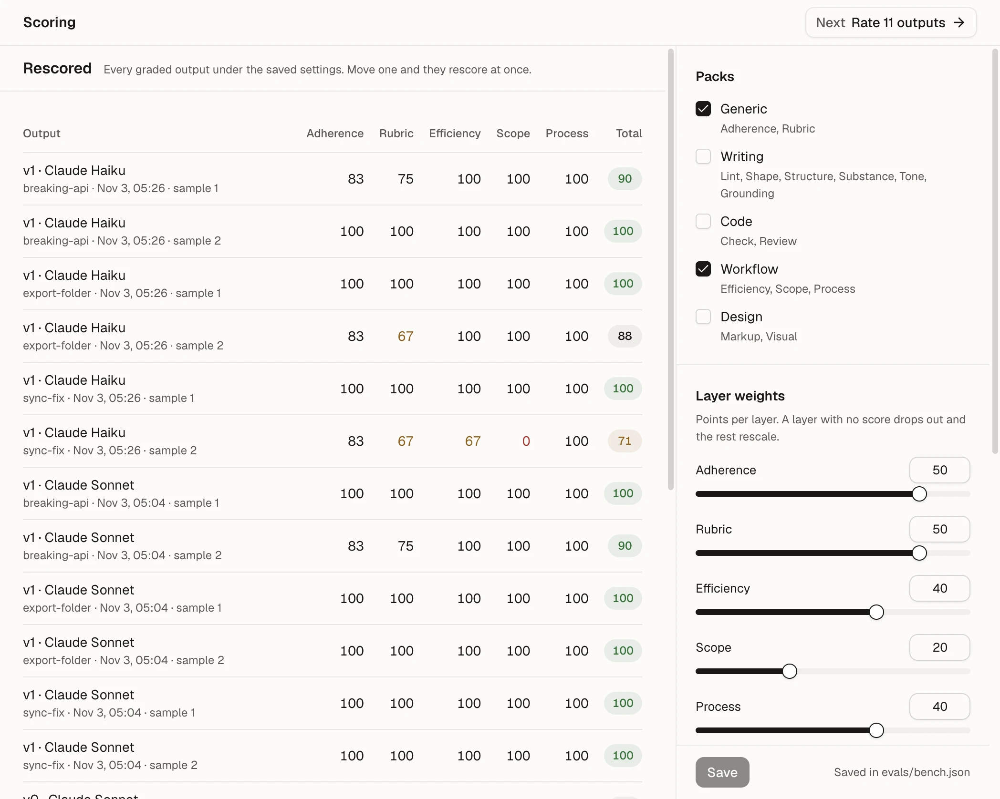

# How to use Skill Studio

This guide walks one skill through the whole loop, from writing it to measuring an edit. For file formats, judge packs and the command line, see the [reference pages](https://github.com/milesroxas/skill-studio#documentation).

## How the loop works

A skill is a `SKILL.md` an agent reads before it works. Skill Studio answers one question about it: does the skill make the agent's answers better, and did your last edit help or hurt?


Each step is a screen in the sidebar.

| Step | Screen | What you do | Why |
| --- | --- | --- | --- |
| 1 | Library | Open or create a skill | Every skill on the machine is in one list, so you test the copy the agents use |
| 2 | Write, Versions | Edit `SKILL.md` and `references/`, save versions | A score stays tied to the text that produced it |
| 3 | Cases | Write the tasks the agent gets | A case is a test: a prompt, what a good answer does, and checks |
| 4 | New run | Run agents on the cases | You grade what an agent wrote, not what you expect it to write |
| 5 | Results | Read the judge's scores | Every answer is graded the same way, so two versions can be compared |
| 6 | Rate blind, Compare | Rate answers before you see their scores | Your ratings are the ground truth the judge is measured against |
| 7 | Agreement | Find where you and the judge disagree | The disagreement tells you whether to fix the skill or the scoring |
| 8 | Scoring | Tune the scoring | A judge that disagrees with you measures the wrong thing |
| 9 | Write | Change the skill and run again | One pass measures a version. The second measures your edit |


The pictures in this guide show a sample skill, `release-notes`. Its scores are made up.

### Finding your way

- The sidebar lists every screen of the open skill. A number beside a screen counts its versions, cases, runs or answers left to rate. A dot marks unsaved work.
- The top of the sidebar names the open skill, its version and that version's mean score. Click it, or press Cmd+K (Ctrl+K on Windows and Linux), to switch skill. Type a name no skill has and press Enter to start a new one.
- When a step is due, a button at the top right names it: "Next: Add a case", "Next: Run v0" or "Next: Rate 11 outputs". It is hidden while a job runs.
- In the desktop app, the two arrows at the left of the top bar go back and forward through the screens you visited, as do Cmd+[ and Cmd+] (Ctrl+[ and Ctrl+]). Back returns to the same case, file or pair of answers, scrolled to where you left it.

### Getting help

- The question mark at the top right says what the screen in view is for and what its words mean. From there you can open this guide at the matching step, open the welcome again, or ask the Assistant.
- The first time a screen of the loop opens, a hint under the top bar says what it is for. "Got it" puts it away for good.
- A word with a dotted line under it, such as Packs on Scoring, opens what it means when you click it.

## Before you start

You need three things:

1. The `claude` CLI or the `cursor-agent` CLI on your `PATH`, signed in. These are the agents that write the answers.
2. A TypeSafe API key from [typesafe.ai](https://typesafe.ai). Jev, the judge, needs it. Without it the app still works, but grading runs code checks only.
3. The app: a packaged build from [Releases](https://github.com/milesroxas/skill-studio/releases), or the repository cloned with Node 24 and pnpm.

## Start the app

Open Skill Studio, or from the repository folder:

```
pnpm install
pnpm dev
```

Then open Settings at the foot of the sidebar and paste the TypeSafe key under Jev key. The app stores it encrypted through your system keychain. While the key is missing, a "No Jev key" label at the top right takes you to Settings.

The first time it opens, the app shows a welcome. "See how it works" tells the loop in six steps on the practice skill and ends on **Start practice**. Skip goes to your skills at any point. In the desktop app the welcome has a small window of its own, and the app opens when you skip, finish or close it.

To see the welcome again, choose "How Skill Studio works" under the question mark, **Open the welcome** in Settings, or the Help menu of the desktop app.

Settings also holds your preferences: the theme, whether to reduce motion, whether Write opens Markdown formatted or as source, whether screens show their hints, and, in the desktop app, whether it looks for new versions on its own.

To use the app in a browser, or from your phone over Tailscale, run `pnpm build` then `pnpm st serve`. The [web server page](https://github.com/milesroxas/skill-studio/blob/main/docs/cli.md#the-web-server) explains who can reach it. In a browser the key comes from `TYPESAFE_API_KEY` in the environment or a `.env` in the checkout.

## Practise on a finished skill first

The fastest way to learn the loop is to go round it once on a skill that is already written. Click **Start practice** in the welcome or in the Library, or "Start with the practice skill" in the New skill form.

The practice skill is `thank-you-note`. It writes a short thank-you note, so a run takes a minute or two and a note is read and rated in seconds. It comes with three cases, and every form on the way is filled in.

A Practice block in the sidebar names the step you are on, and clicking it takes you there:

1. **Run the skill.** New run opens with the cases ticked and the version named. Click "Start a run".
2. **Rate the notes.** Score each note in Rate blind before you see the judge's score.
3. **Tighten one rule.** One rule is vague on purpose: "Keep the note to a reasonable length." The agent cannot measure "reasonable", so the notes come back long and each case's "exactly two sentences" check fails. Write shows the vague rule beside an exact one. Click "Use the exact rule", or write your own, then Save.
4. **Run it again.** The same cases against the new rule. Only the skill changed, so any difference is your edit.
5. **Compare the versions.** Read a note from each version side by side and vote for the better one.

The practice skill is kept in `~/.skill-studio/practice/`, outside every folder agents load skills from, so practising never changes what your agents do. To start it over, delete that folder and open it again from the New skill form.

## 1. Open or create a skill

The Library lists every skill in your user skills folders (`~/.agents/skills`, `~/.claude/skills`, `~/.cursor/skills`, `~/.codex/skills`) and in projects under your workspace folders. The app opens there until you have opened a skill, and on your last skill after that.



To work on a skill that exists, find it in the list or type in the search box, then click its name. "In progress" holds the skills that have cases or runs, and the ones you opened before.

To see a skill's files on disk, click the folder icon at the end of its row. The desktop app shows the skill's folder in Finder, in File Explorer on Windows, or in your file manager on Linux. For the open skill, the same step is at the foot of the skill list at the top of the sidebar.

To create one:

1. Click New skill.
2. Under "Start from", pick a template. Blank is a title and an empty Rules section. Writing, Code, Workflow and Design are each a small finished skill of six to eight rules in the shape the judge grades, with three sample cases. Leave "Add 3 sample cases to run against" ticked to have something to run at once.
3. Type a name: lowercase letters, digits and single dashes, like `release-notes`.
4. Write a one-line description. Agents read it to decide when to use the skill, so say what it is for.
5. Pick a Place. "User (every project)" makes it available everywhere; a project place keeps it in that project.
6. Under "Install for", tick the agents that get it.
7. Click Create skill. The app opens the new skill on Write.

The skill is written to `.agents/skills/<name>` and linked into each agent you ticked. A Writing, Code, Workflow or Design skill also gets an `evals/bench.json` that turns on the matching judge pack.

The Claude, Cursor and Codex buttons on a skill's row install or uninstall it later. Uninstalling removes the link only, never the skill. A button marked "copy" means that agent has its own copy of the skill, and edits you make here do not reach it.

When a skill is missing from the list:

- It was installed from somewhere else, or you clicked "Not mine" on its row. Choose Installed or All beside the place filter. "Mine" on its row lists it with your own skills again.
- Its project is outside your workspace folders. Open "Where skills are found" at the bottom and add the project's parent folder. Projects are found up to three levels inside a workspace folder. The default is `~/SITES` when that folder exists.
- It was added a moment ago. The list is read again when you return to the window, or when you press the round arrow beside New skill.

## 2. Write the skill

Open Write. The left column holds the skill's files, the Insert buttons, the Graded rules and the Version. The editor fills the rest.



1. Edit `SKILL.md` in the editor. Save with the Save button or Cmd+S (Ctrl+S on Windows and Linux).
2. Add longer material as files under `references/`: press the plus button beside Files, type a name such as `references/voice.md`, and click "Add file". Point to the file from `SKILL.md`, and say when the agent must read it.
3. Check the Graded rules list. It shows the rules exactly as the judge will read them.

### What the judge grades

The generic pack scores each answer against the skill's rules, one judge question per rule. A rule is a top-level bullet (`-` or `*`) of four words or more:

- Indented lines and nested bullets belong to the bullet above them, as part of that rule.
- A numbered list is never graded. Put steps and checklists there.
- A sentence inside a paragraph is never graded. If it must hold, make it a bullet.
- A bullet that is only a link is skipped.

### How to write a rule

A rule changes what the agent does only when the agent can act on it the same way every run. Hold each rule to these six tests:

1. **Encode the process, not the outcome.** "Lead with the change for the reader" beats "write clearly". The agent can walk a step; it cannot measure an adjective.
2. **Write the why in the same bullet.** A rule with its reason extends to cases you did not write down. A bare rule is applied blindly, including where it does not belong.
3. **Be numeric or absolute.** "Under 120 words", "never", "always". "Reasonably" and "try to" give the agent nothing to act on.
4. **Cut every line that does not change what the agent does.** Each definition the agent already knows takes attention from your rules.
5. **One skill, one aspect.** Writing, code, workflow or design. A skill that covers everything is followed on nothing.
6. **Test it by running it.** A rule is a guess until a run shows it changed the answers. Steps 4 to 7 are that test.

```
Vague, and no reason:
- Try to keep notes reasonably short.

Strict, with its why:
- Keep the note under 120 words. A note longer than one screen is not read.
```

The left column helps you start:

- The Insert buttons (Rule, Decision tree, Process, Reference link) put that shape at the cursor, written the way that grades well.
- "How to write a rule" under Insert is the method above in short.
- A `SKILL.md` that holds only headings shows "Start from a template": each template is a finished small skill to edit. Once the file has text, "Start over from a template" does the same behind a confirmation.

### The editor

A switch beside the file's name picks the view, and the app remembers your choice:

- **Formatted** styles the Markdown in place: headings, bold, lists and links read as a page, and their marks (`#`, `**`, a link's address) appear only where the cursor is.
- **Markdown** shows the plain source. Both views edit the same characters, so switching never changes the file.
- **Changes** shows your draft against the file on disk.

The toolbar writes the Markdown for headings, bold, italic, code, links, lists and quotes. ⌘B, ⌘I and ⌘E (code) do the same from the keyboard, and ⌘⇧X strikes text through. Type `- [ ]` for a task, then click its box to tick it.

Undo and Redo lead the toolbar (⌘Z and ⌘⇧Z). A file keeps its undo history while the app is open, also after you look at another file or screen. Applying a template, discarding a draft and text written with AI can all be undone.

Everything you type is kept as a draft in `~/.skill-studio/drafts/`, outside the skill's folder, so unsaved text survives closing the app. The line beside the file name says so ("Unsaved · draft kept 3:42 PM"), and the sidebar shows a dot beside Write. Save writes the file and clears its draft; Discard throws the draft away.

A save is refused if the file changed on disk since your draft began, so an edit made in your code editor is never overwritten. Choose "Keep my draft" to save over the file, or "Use the file on disk" to take the file as it is now.

### Write with AI

The app can write with you once it is connected to a model. Settings has two ways to connect each of Anthropic and OpenAI: store an API key, which bills each request to your API account, or use the `claude` or `codex` command you are already signed in to, which uses your plan. Under Assistant in Settings, pick the model and its effort.

Every text area has a small button in its corner, and the editor has "Write with AI" in its toolbar. Press it, say what to write or change, and read the text as it arrives.

- Nothing touches the field until you press Replace (or Insert, for an empty field). Discard drops the text.
- In the editor, select some text first to rewrite only that. A whole `SKILL.md` comes back as a change to the file, line by line.
- Under a case's checks, "Write checks with AI" writes new checks, and Add puts them at the end of the list.
- A request can carry up to six pictures: press the picture button, paste one, or drop one on the request. A request about a case also carries that case's pictures.

The text comes back in the shape the field holds: a `SKILL.md` is rules in the graded form, a check is one fact a judge can mark, and a description says what the skill does and when to use it.

The Assistant panel opens from the button at the right of the top bar, or with ⌘J. It is one conversation that stays beside whatever screen you are on and is still there after a restart. It reads the open skill and its cases as saved, and changes nothing. From it you can change the model, start a new conversation, and open Usage: requests and tokens today and over the last 30 days, by model.

### Save versions

Open Versions. When the saved files are not a version yet, name them, say what changed and why, and click the save button: "Save as v0" for the first version, then v1, v2 and so on. A version keeps its own copy of `SKILL.md` and `references/` in `evals/versions/`, so it travels with the skill. It holds the saved files only, so save your drafts in Write first.

The history lists every version, newest first, with its runs and its mean score. A run also names a version: runs and saved versions share one numbering. From the history:

- Changes shows that version's files against the files now. Under Changes, pick any two versions in From and To.
- Restore puts a version's files back, after asking. It warns you when the files now are not a version, because restoring would lose them.
- Delete (the bin at the end of the row) removes a version. The skill's files stay as they are. If the version has runs, you are asked first: deleting it deletes those runs too, with their outputs, reviews and votes. Click Undo in the message that follows, or press ⌘Z, to bring it all back. Only the latest delete can be undone.

## 3. Write cases

A case is one task an agent gets with your skill installed. Open Cases. With no cases yet, the form for the first one is already open; after that, press the plus button above the list.


A new case offers "Start from an example": three finished cases for the kind of skill your bench grades (Writing, Code, Workflow or Design). Pick one and the whole form fills in. Edit it into your task.

1. Title: a short name for the task.
2. Id: filled in from the title. It names the case's folder and cannot change after you add the case.
3. Prompt: exactly what the agent is asked, worded the way a user would ask. Never mention the skill: the test is whether the agent finds and uses it on its own.
4. Pictures: a screenshot, a mock-up or a photo the prompt is about. Click Add pictures, or drop one anywhere on the case. The agent gets each one as a file, and the judge sees them beside the prompt.
5. A good answer: one or two sentences on what a good answer does. You see this when you rate, and the judge reads it too.
6. Checks: one statement per row that a good answer makes true, such as "The note says where to find the change." The judge marks each one. Set a check's weight from 1 to 5; a weight of 2 counts twice. "What the judge can mark" shows three vague checks next to the form the judge can mark.
7. Length: tick "Score the output's length in words" and set the range when length matters. Only prose and list text count, not headings or code.
8. Click Add case.

A check can be about a picture of its own, such as "The page matches the mock-up": press the picture button on its row. Only that check is asked with it.

The app redraws every picture you add: upright, as a PNG or JPEG, and between 280 and 1568 pixels a side, the sizes the judge reads. A picture you put in a case folder by hand is sent as it is. One outside those sizes still reaches the agent, and the job log says the judge did not see it.

A case can come with other input files the prompt refers to. The form lists them but cannot add them: put them in `evals/cases/<id>/files/` in the skill's folder.

Write at least three cases before you trust a score, and make them differ. One case measures one task; a skill is meant to help across many.

## 4. Run the agents

Open New run.



1. Skill version: if the skill changed since the last run, this run starts a new version. Type what changed, so the version is easy to recognise later.
2. Cases: tick the cases to run.
3. Writers: pick the agent, model and effort. Add up to four writers to compare agents or models. Each writer makes its own run.
4. Samples per case: how many answers each writer gives per case. Agents vary run to run, so use 2 or more before you trust a difference between versions.
5. Skill: choose what the agent gets. "With skill" installs this skill. "Without skill" installs nothing, which is the baseline the skill has to beat. "Old skill" uses an earlier run's copy, picked under "Copy from", to test an edit against the version before it.
6. Leave "Grade when done" ticked so scores appear when the run finishes.
7. Click "Start a run". The line beside the button counts the outputs it will write: cases times writers times samples.

The run happens in the background, and you can keep working on other screens. The foot of the sidebar names the running job and counts its outputs as they are written; click it for the log. In the Library, the skill's row says it is running.

Runs cost money: each answer is one agent session, and grading makes judge calls.

## 5. Read the results

Open Results. Once one writer has run on two versions of the skill, the top of the screen shows the version lift: the latest version's mean, what it gained since the first, and a ribbon from the first version's score to the latest, over the same writer's score without the skill.

Each row is a run: its version and writer, then a score per case, the mean, the cost, the time and the number of flags. A flag is one thing the judge found wrong, such as a rule not followed.


- Click a score to open that answer in Compare, with its total split into layers such as adherence to the skill's rules and the rubric of your checks.
- Click a run to open its samples. Each has a Compare link for its answer and a Transcript link for the agent's steps.
- "Changes since this run", in an open run, opens Versions with that run's version against the files now.
- Regrade grades the run again, for example after you added checks.

Read the layers, not only the total. A total can hold steady while one layer falls. The [grading page](https://github.com/milesroxas/skill-studio/blob/main/docs/grading.md) lists each pack's layers.

A score from a judge is a claim, not a fact. Step 6 tests it.

## 6. Rate answers blind

Open Rate blind. The answer is on the left and your review on the right.



The queue holds the graded answers you have not rated. Answers the judge was least sure about, and cases whose samples scored far apart, come first, because your rating tells you the most there. The chip at the top left ("1 of 11") opens the whole queue.

For each answer:

1. Read the answer. Open "The prompt and what the case checks" above it for the prompt, what a good answer does, and the checks.
2. Give it a rating from 1 to 5. 1 is unusable; 5 ships as is.
3. Mark each layer Good or Bad where you have an opinion.
4. Add a note on what works and what the skill should have done. Notes are what you act on later.
5. Click "Save and reveal". Skip moves to the next answer without rating this one.

The scores and the writer stay hidden until you save or choose "Reveal without saving". Seeing the judge's score first pulls your rating toward it, and then your rating no longer tests anything.

After the reveal you can:

- Compare it with another output.
- Make it an anchor: a labelled good or bad example the judge must rank correctly. Run `pnpm st self-test <skill-dir>` to check all anchors. Trust a judge pack only once its anchors pass.

### Compare two answers

Compare puts two outputs side by side, or as a word diff of their text. Pick them under A and B.



Under "Which is better?", pick "A is better", "Tie" or "B is better". The vote is on "overall" unless you type another criterion, such as "warmth".

"Ask Jev" has the judge vote on the same pair. For "overall" it counts rules broken and checks failed. When Jev is less certain than the "Unsure below" threshold, the screen says it was unsure and the vote is not counted.

The votes feed the leaderboards lower on the screen, one for your votes and one for Jev's, which rank the outputs from head-to-head picks (a Bradley-Terry model). People and judges agree more on which of two answers is better than on how good one is.

### Read a transcript

Transcripts shows every step an agent took on one sample: its messages, tool calls and errors. Read it when a score surprises you. It tells you whether the agent read the skill at all, and where it went wrong.

## 7. Check the judge against you

Open Agreement. This screen fills in once you have rated some answers.



"Your marks against the judge" counts, per layer, the answers you marked Good or Bad against the judge's score for that layer. Each count falls in one of four columns, and the column says what to change:



Under the table the app gives one verdict per layer:

| The verdict | It means | Do this |
| --- | --- | --- |
| change the skill | You and the judge agree the answers fall short | Edit the rule the flags name (step 2), then run again |
| tune the scoring | The judge scored answers high that you marked bad, or low that you marked good | Tune that layer (step 8) |
| holding | You and the judge agree the answers are good | Nothing |

The rest of the screen checks the judge as a whole:

- "Your rating against the judge's total" gives the rank correlation between your 1 to 5 ratings and the totals. It needs 3 or more ratings. Above 0.6 the judge ranks answers the way you do.
- Pairs lists each pairwise pick where the judge's totals chose the other answer. If the judge gets your picks wrong, it cannot tell good from bad here: add anchors, then check the pack's settings.

## 8. Tune the scoring

Open Scoring. The settings are on the right; every graded output is on the left.



Move a setting and every graded output rescores at once, with the change shown beside each total. No new judge calls are made: the judge's raw answers are stored and the scoring is applied in code.

- Packs: which judge packs grade this skill.
- Layer weights: points per layer. A layer with no score drops out and the rest rescale.
- Thresholds: "Yes at" is when a judge answer counts as yes, "Unsure below" is when it is listed as unsure and when a Jev vote on Compare is not counted, and "Good at" is the layer score Agreement counts as good.
- Judge pack settings: each active pack's numbers, such as how many repeated tool calls the workflow pack allows. A pack's text settings, such as the writing pack's lint command, are set in `evals/bench.json` by hand.

Click Save to write them to `evals/bench.json`. Unsaved changes show as a dot beside Scoring in the sidebar.

Change one setting at a time, then reread Agreement. Moving several at once hides which one helped.

## 9. Change the skill and run again

This is the loop. Go back to step 2 with what you learned:

1. Read your notes and the Agreement screen.
2. Edit the skill to fix what the bad answers have in common, not a single answer.
3. Save the files as a version on Versions, with what changed and why. A run of unsaved files asks for a name instead.
4. Start a run, then compare the two versions' scores on Results and their files on Versions.

To be sure an edit helped, run it against the version before with the "Old skill" option on the same cases, with 2 or more samples per case. A difference smaller than the spread between samples of the same version is noise.

## Use it from the command line

Runs, grading and reports can also be scripted from a checkout. The CLI uses the same files as the app.

```
pnpm st new <skill-dir> --template writing --with-cases
pnpm st run <skill-dir> --engine claude --model sonnet --samples 2 --name "what changed"
pnpm st report <skill-dir> --run <run-name>
pnpm st compare <skill-dir> <runA> <runB>
```

The [command line page](https://github.com/milesroxas/skill-studio/blob/main/docs/cli.md) lists every command.

## Where your data lives

Everything but unsaved drafts is plain files inside the skill's `evals/` folder, so it can be committed and reviewed like code.

| Path | Holds |
| --- | --- |
| `evals/cases/<case>/` | the prompt, `case.yaml`, checks under `graders/`, input files and pictures under `files/` |
| `evals/versions/<vN>/` | a version saved on Versions: its name, note and files |
| `evals/runs/<run>/` | one folder per run: the skill snapshot, each sample's output and transcript, and `report.json` |
| `evals/reviews.json` | your ratings, notes and pairwise votes |
| `evals/anchors/` | labelled good and bad examples |
| `evals/bench.json` | the scoring settings from step 8 |

The agent never sees `evals/`: its copy of the skill leaves it out, so it cannot read the checks or your ratings.

The app's own files, such as drafts and the Assistant's conversation, are in `~/.skill-studio/`. The [files page](https://github.com/milesroxas/skill-studio/blob/main/docs/files.md) has every path.

## When something goes wrong

| Problem | Fix |
| --- | --- |
| "No Jev key" at the top right | Paste the key under Settings; in a browser, set `TYPESAFE_API_KEY` and restart `st serve` |
| An agent shows "(not set up)" in New run | Install that CLI, put it on your `PATH` and sign in |
| A skill is missing from the Library | Choose All beside the place filter, press the round arrow to look again, or add its project's parent folder under "Where skills are found" |
| "Port 4400 is taken" (`st serve`) | Stop what holds it (`lsof -nP -iTCP:4400 -sTCP:LISTEN`) or start with `--port` |
| A save in Write is refused | The file changed on disk. "Keep my draft" saves over it; "Use the file on disk" takes the file as it is now |
| A rule is missing from Graded rules | Make it a top-level bullet of four words or more, outside a numbered list or a code block |
| A score looks wrong | Read the transcript, then rate it blind; Agreement will show if the judge is off |

Run skills you did not write in a container or VM. The code pack runs code the agent wrote, with your permissions. [SECURITY.md](https://github.com/milesroxas/skill-studio/blob/main/SECURITY.md) has the details.
