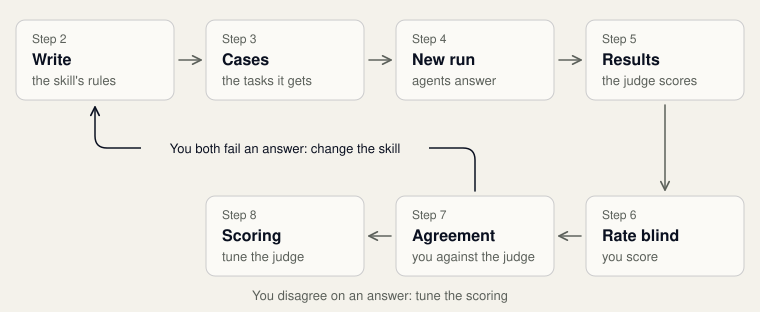
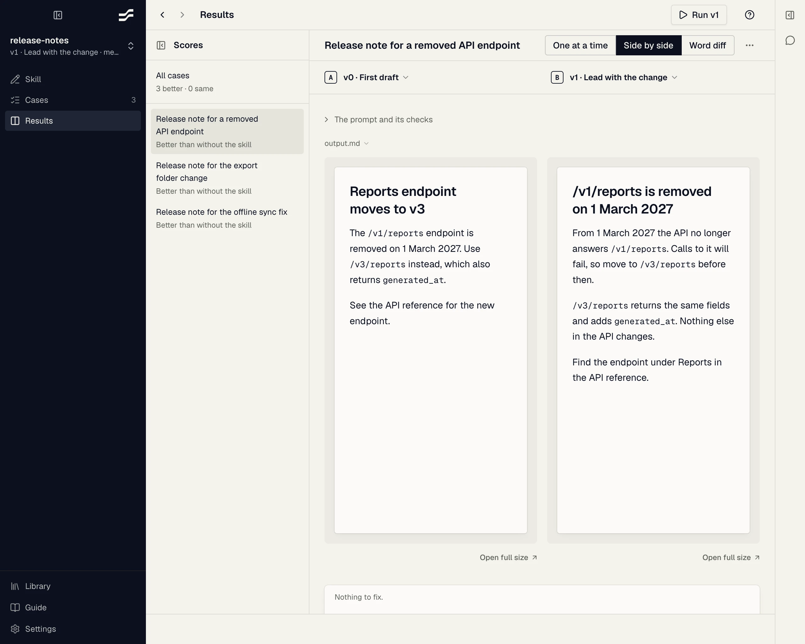
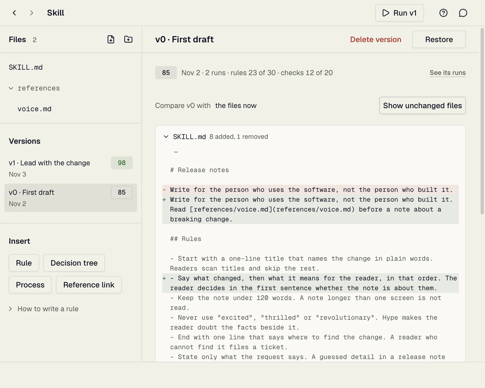
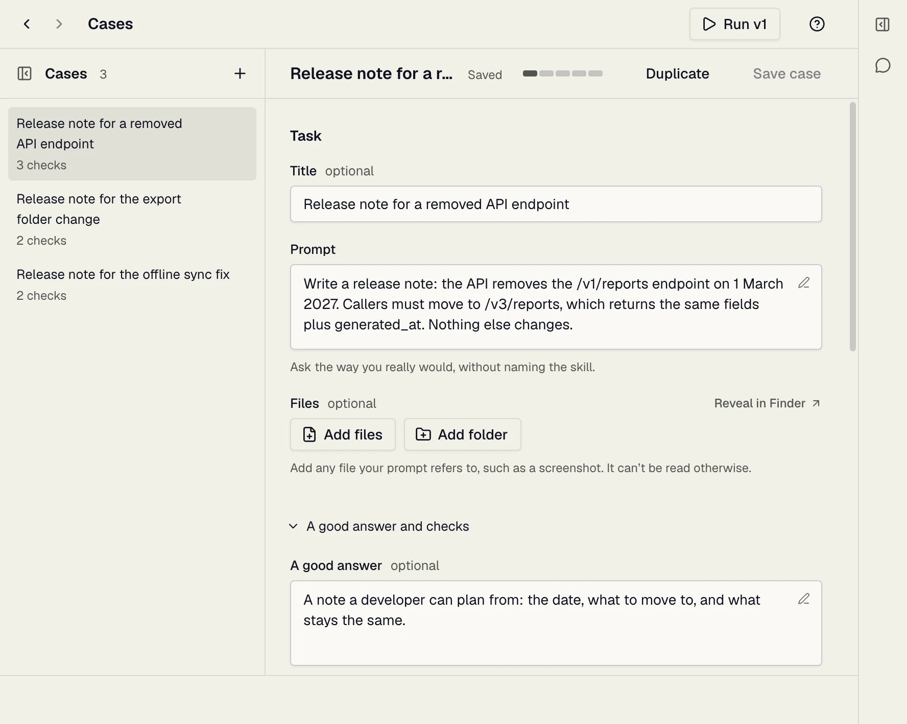
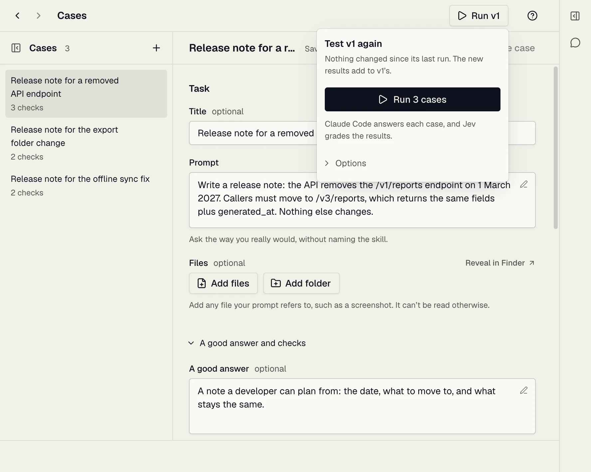
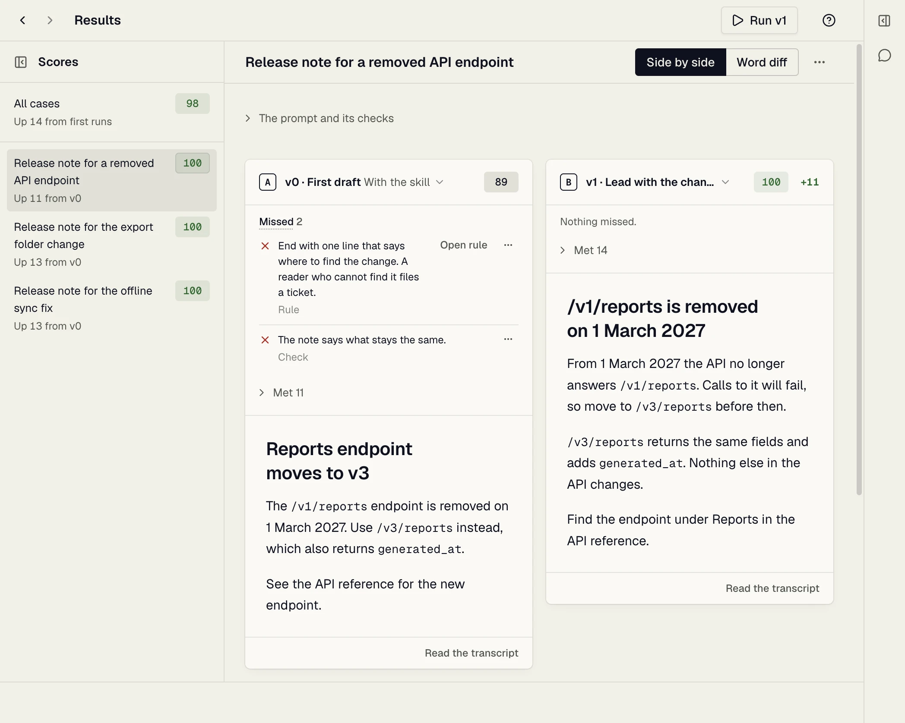
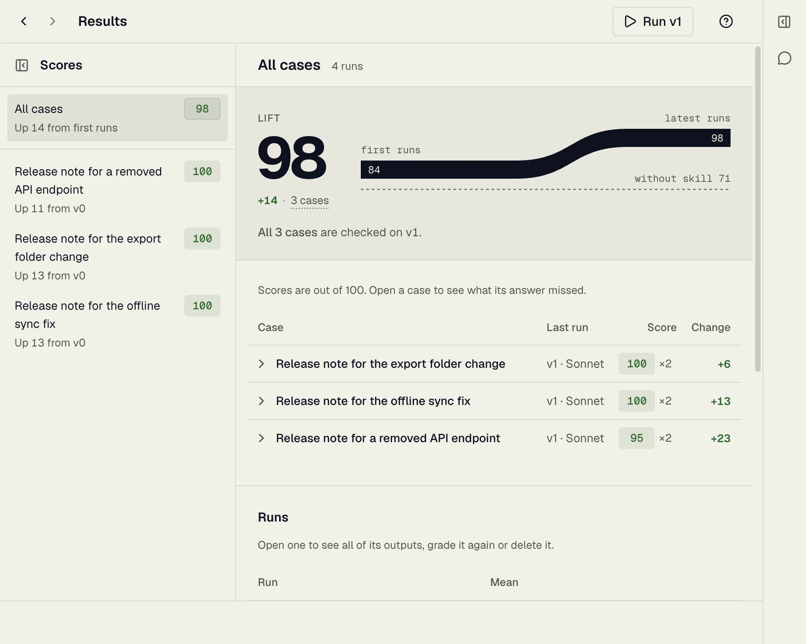

# How to use Skill Studio

A **skill** is a page of instructions that an AI agent, such as Claude Code, reads before it does one kind of task. Skill Studio helps you write one and shows whether each edit makes the agent's answers better.

## How it works



You go round three steps:

1. **Write** the skill's rules, on the **Skill** screen.
2. **Run** it: click **Run** at the top right. An agent answers a few test tasks, called **cases**, using your skill.
3. **Compare** on the **Results** screen: each answer gets a score and a list of what it missed, beside the answer from your last version.

Then change a rule and go round again.



The pictures in this guide show an example skill that writes release notes. Its scores are made up.

### Who decides what is good

You do, in writing. The skill's **rules** say what the agent should always do. Each case's **checks** say what a good answer to that task contains.

**Jev** is the grader: an AI model that reads every answer and marks each rule and check as met or missed, the same way every time. The score, out of 100, counts what was met. When you think Jev got one wrong, you can mark it yourself.

### Finding your way

- **Sidebar:** Skill, Cases and Results for the skill you have open. Library, Guide and Settings sit at the bottom.
- **Top right:** the **Run** button, a yellow button when there is a next step to take, and the **?** that explains the screen you are on. The Assistant is the strip on the right edge.
- **Make room:** drag the line beside the sidebar, the list of cases or the Assistant to make it wider or narrower. The button at its top hides it to a narrow strip; click the strip to show it again. `Cmd+\` hides the sidebar, `Option+Cmd+\` the list, Cmd+J the Assistant.
- **A word with a dotted underline:** click it to see what it means.
- **Right-click** a skill, a case, an answer or a rule to see what you can do with it.
- **Switch skill:** click the skill's name at the top of the sidebar, or press Cmd+K.
- **Keyboard shortcuts:** press **?** to see them all. **1**, **2** and **3** go to Skill, Cases and Results, and **R** opens Run.

On Windows and Linux, press Ctrl where this guide says Cmd.

### Keyboard shortcuts

Press **?** anywhere, or choose **Keyboard shortcuts** under the **?** at the top right, to see every shortcut. A shortcut without Cmd does nothing while you type in a field: click outside the field first, or use one with Cmd.

To change one, open **Settings**, find **Keyboard shortcuts**, click the shortcut and press the new keys. Esc cancels, and Delete turns the shortcut off. If another shortcut already used those keys, it moves to the one you changed, and **Undo** at the foot of the window puts it back. Keys your computer uses, such as Cmd+C for Copy, cannot be picked. **Use the original shortcuts** puts every one back.

## Start the app

You need three things:

1. **Skill Studio.** Download it from [Releases](https://github.com/milesroxas/skill-studio/releases).
2. **Claude Code or Cursor**, installed and signed in. This is the agent that answers your cases.
3. **A TypeSafe key**, so Jev can grade. Get one at [typesafe.ai](https://typesafe.ai). Without it, no rule or check is marked.

The first time you open the app, a welcome asks how you want to start:

- **Try it on a sample skill** opens the walkthrough below. Most people start here.
- **See how it works** shows the three steps first, then opens the same sample skill.

If you have no TypeSafe key yet, the welcome asks for one. Click **Configure later** to skip it. You can add it any time in **Settings**. Until you do, a **No Jev key** button at the top right takes you there.

To see the welcome again, click **?**, then **How Skill Studio works**.

## Take the walkthrough first

The walkthrough takes a finished sample skill, **Thank-you note**, once round the loop. You type nothing, and a run takes a minute or two. Open it from the welcome, or with **Start the walkthrough** in the Library.

The **Walkthrough** box at the bottom of the sidebar shows your step. Click it to go where the step happens. The yellow button at the top right does the step.

1. **Run the skill.** Click **Run**, then **Run 3 cases**. The agent writes a thank-you note for each case.
2. **Read what the notes missed.** Results shows each note with its score and what it missed.
3. **Tighten one rule.** One rule says "Keep the note to a reasonable length". It is vague on purpose, so the notes come back too long. The Skill screen offers an exact rule instead: click **Use the exact rule**, then **Save**.
4. **Run it again, then compare.** Only that rule changed, so any difference comes from your edit. Read the two notes side by side.

To start over, click the skill's name at the top of the sidebar and choose **Restart walkthrough…**.

## 1. Open or create a skill


The **Library** lists every skill on your computer.

- **Open a skill:** click its name, or type in the search box to find it.
- **In progress** holds the skills you are working on. **Mark done** moves one to **Other skills**.
- **Claude, Cursor, Codex:** turn the skill on or off for that app. Turning it off never deletes it. It turns off a link to the skill under any name.
- **Folder icon:** shows the skill's files on your computer.

**To make a new skill:**

1. Click **New skill**.
2. Type a name in lowercase, with dashes, such as `release-notes`.
3. Write one line on what it is for. The agent reads this line to decide when to use the skill.
4. Pick a template. **Blank** starts empty. The others start with example rules, and can add three example cases.
5. Click **Create skill**.

**A skill is missing?** Choose **Every place** in the filter and clear the search. If it is still missing, open **Where skills are found** at the bottom and add the folder it is in.

## 2. Write the skill


Write the skill in the editor, then click **Save** (Cmd+S). Your unsaved text is kept even if you close the app.

- **Rules are bullets.** Each bullet of four words or more gets a number, such as 01, and Jev grades it. A bullet that keeps its dot is not graded: point at it to see why. A skill written only as numbered steps has its steps graded instead.
- **An amber number** means the rule could be clearer. Click it to see why and to get help. It goes as soon as you fix what it names. A rule can be as long as it needs to be.
- **A red number** means most answers broke the rule the last time it ran. Point at any number to see how many answers broke it. Run the cases again after a fix to see it change. Where a case also ran without the skill, the number says how many of those answers followed the rule anyway: a rule the agent follows without being told may be one you can cut.
- **Formatted** shows a table as a table and colors the code in a code block. Click a table or a code block to edit it as text.
- **Changes**, at the top right, shows what you changed since the last version. While the file has unsaved text, click **The last save** there to see only that.
- **Files**, on the left, lists every file of the skill: SKILL.md, its references, its scripts and anything else it holds. Click one to edit it. A picture, or another file that is not text, is listed and cannot be opened.
- **Add a file** and **Add a folder**, the two buttons beside Files, add one next to the file that is open: in its folder, or beside SKILL.md. Type its name where it appears in the list and press Enter. A name with no ending, such as `voice`, becomes `voice.md`.
- **Right-click** a file or a folder to add a file or a folder there, or to delete the file. Click a folder to fold its files away.
- A folder is kept once a file is in it, so a new folder asks for its first file.
- **Insert**, on the left, adds a ready-made rule, decision tree, step list or link.
- **The five bars** in the toolbar show how long the file is. Amber means getting long, red means too long.

### How to write a good rule

- **Say what to do, not the result you hope for.** "Open with what changed for the reader", not "write clearly".
- **Give the reason in the same bullet.** It tells the agent where the rule stops.
- **Make it checkable:** a number, a limit, or always, never or only.
- **Leave out what the agent does anyway**, such as "be accurate".
- **Keep to one job.** Rules for another job belong in another skill.

```
Leaves the agent to guess:
- Release notes should be clear and not too long.

Says what to do, and why:
- Open each note with what changed for the user, in one sentence. Most readers stop after the first line.
```

This way of writing rules comes from Emil Kowalski's course [AI for Designers and Engineers](https://aiforui.dev), which made Skill Studio possible.

### Get help from AI

First, connect a model in **Settings**. If you use Claude Code or Codex, it works with the account you already have. Settings shows what to do if one is not signed in.

- **Write with AI**, in the editor toolbar or in any text box: say what you want. Nothing changes until you click **Replace** or **Insert**.
- **Select a rule** to get three choices: **Auto refine** fixes what is unclear, **Suggest changes** offers three rewrites, and **Help me improve** works through it with you in a chat. Nothing changes until you pick a result, and **Undo** takes it back.
- A rule that asks for several things gets **Split up** among its rewrites: one rule for each thing, so you can see which one an answer missed.
- **The Assistant** (the strip on the right edge, or Cmd+J) is a chat that reads your skill and suggests changes. You apply each one with a click. Click **Thought for 12s** over a reply to read what it thought first.

### Versions



Each run keeps the skill as it was, as a **version**: v0, v1 and so on. **Save** only writes the file: it makes no version. Every score stays with the version that earned it.

After you save an edit, **Edited since v1** appears over the versions, and under the skill's name. It means your files have changed since v1 and have not run yet. Click it to see what changed. The next run keeps them as v2.

Once one model has run two versions, every version's score is that model's, so the scores read against each other. A version it never ran shows the score of the model that did run it, and its line names that model, such as **With Sonnet, high effort**. A version only several other models ran shows no score, and says **Not run with** the model the other scores are from.

- **Click a version** to see what changed since, in every file of the skill.
- **Older versions** fold under one line once the list grows long. Click it to see them.
- **Restore** puts a version back: every file of the skill as it was then. It asks first when your files hold edits no version keeps, and edits you have not saved are lost with it. A version kept without its scripts and other files says so, and Restore leaves those as they are.
- **Delete version** removes it and its runs. **Undo** brings them back.
- **Recently deleted**, under the versions, lists the versions and runs you deleted in the last 30 days, the newest 10. **Undo** on one brings it back, even after the app restarts.

## 3. Write cases

A **case** is one test task: what a person would ask the agent, and what a good answer contains.



Start with the request alone. Reading the first answer shows you what to check.

1. Click **+** above the list.
2. **Prompt:** type what a person would ask. Do not name the skill: the test is whether the agent uses it on its own. **Start from an example** fills in a finished case.
3. **Files** (optional): add any file the prompt mentions, such as a screenshot or a document. The agent sees only what you add here, not the rest of your computer.
4. Click **Add case**.

When you know what a good answer looks like, open the case again and add:

- **Checks:** one fact per row that a good answer makes true, such as "The note mentions the wedding". **×2** makes a check count double.
- **A good answer:** a sentence or two describing it.
- **Length:** the fewest and most words an answer may have.

**Suggested by the assistant** shows under a case's checks when the assistant has read the case's latest runs and suggests checks for it, the ones an answer missed first. Once a case has run, click **Write checks with AI** under its checks to have the assistant read the latest runs. It takes a few seconds, on the model you chose in Settings, and **Stop** beside the button ends it. When a case's answers are long, it asks first, and says how many usual readings it counts as. Before a first run, the same button writes checks from the prompt. **Why** says why each matters, the words in your case that ask for it, and what an answer wrote instead. **Add** puts a check in the case as if you typed it: click **Save case** to keep it. The cross turns a suggestion down, and **Undo** at the foot of the window brings it back. `st propose` does the same for many cases at once from the command line ([cli.md](cli.md#proposing-checks)).

Some answers come as two files: a page, and a picture made from it. After a first run of such a case, **File to grade** appears at the top of these, with the two files by name. Pick the one you would use: only that file is graded. An answer of several other files is graded on the one the prompt names, such as `post.md` in "Write the post to post.md", and Results says which file the score is for.

The bars at the top of a case show its **run size**, from small to very large: a larger run takes longer and costs more. Pictures, files and an answer that is a page or a picture add the most. Checks add almost nothing, so write as many as the answer needs. Point at the bars to see what adds to the size, and what the last run of the case cost.

In a wide window the run size stands beside the form, and wider still the last answer to the case shows next to it, so you can write its checks with the answer in view.

**Duplicate**, at the top of a case, copies it so you can try a variation. Write at least three different cases before you trust a score.

## 4. Run it



1. **Save** your skill first. A run tests the saved file.
2. Click **Run** at the top right.
3. If you changed the skill, type what you changed under **What changed**. It names the new version.
4. Click **Run 3 cases** (the number is how many cases you have).

The first time, the button reads **Run without skill**. That run shows how the agent does with no skill at all: the score your skill has to beat. To skip it, open it and click **Test the skill instead**.

The run's progress shows at the bottom of the sidebar. Click it to watch, or to **Stop**. Each run costs a little money: the agent and Jev are both paid services.

**Options**, in the Run panel, lets you leave out cases, run an older version, pick another agent or model, and set **Attempts per case**. An older version kept without its scripts and other files says so under **Version**: a run of it gets SKILL.md and references only. Two or more attempts show whether a result was luck, since the agent answers a little differently each time.

## 5. Compare the results



Results shows one case at a time: **A**, the answer from your previous version, and **B**, the answer from your latest. Their versions stay at the top while you scroll. Nothing there scores them: read both answers first and make up your own mind.

- **The list on the left** has every case with how it did, in words such as **Better than without the skill** or **Same as v1**, or, for a skill with no checks yet, its score. Click one to open it.
- **Click a version name** at the top to read a different answer on that side.
- **The answers** are under the two versions. **One at a time** shows one answer large: click the other version, or press A or B, to flip between the two. **Side by side** shows both. **Word diff** marks the words that differ.
- **Scroll inside an answer** by clicking it first. Until you do, scrolling moves the whole screen, so a long answer never holds you. Move the pointer off the answer to scroll the screen again.
- **The file name** over the answer changes which file you read, when the agent wrote more than one. An answer opens on its page or picture when it has one, and code is colored by its language. **Transcript**, last in that list, shows every step the agent took. Read it when a score surprises you.
- **What to fix** comes first under the answer: each rule and check it did not meet, grouped by why, in the order to fix them. **The skill was never opened** means the agent never read your skill, so what it missed says nothing about your rules: work on the skill's description. **No rule was broken, and a check was still missed** means your rules ask for the wrong thing or leave out what the check needs. **A rule was broken on this answer too** lists checks missed beside a broken rule: fix the rule first. **A rule was broken** lists the rules it did not follow. **Open skill**, **Open rule** and **Edit case** take you to where the fix is. A long rule shows its first two lines: click it to read all of it.
- **Fix with AI** on a broken rule has the assistant read what the answer wrote and draft a change to the rule. It opens a box under the button: one line on what in the answer broke the rule, then the rule with the change marked. **Apply and run** saves the new rule in SKILL.md and runs this case once more, with the model that wrote the answer, as a new version named after the fix. Its answer shows on the case when it is graded. **Turn down**, or a click elsewhere, drops the draft. When the answer did follow the rule, the draft says so and leaves the rule as it is. **Open rule** is in the row's menu.
- With both answers in view, the list is B's, and a row says when A did otherwise, such as **A missed this**. To mark one of A's rules or checks yourself, show A alone.
- **Missed** lists what no reason explains: an answer written without the skill was held to no rule, so its missed checks are here. Missed also says when Jev read only the start of a file beside the answer, or of an answer too long even to read in parts: a rule broken past that point is not seen.
- **Not sure** lists what Jev could not tell. These are left out of the score until you mark them yourself with **Mark as met** or **Mark as missed** under each. Where a score leaves some out, All cases says how many of its rules and checks Jev was not sure of. A change between two runs counts only the rules and checks marked on both, and says how many it left out: mark a rule or check on both runs to count it in the change.
- **Not read** lists what Jev could not settle on an answer too long to read at once. Jev reads such an answer in parts, and a rule or check the parts do not settle, such as a footer only the last part holds, is left out of the score until you mark it yourself.
- **Cannot be marked** lists rules and checks written so that two careful readers would mark them differently, rules that cannot hold beside another rule, and, on one case's answers, a rule that cannot hold beside one of that case's checks, such as a word limit beside a check that asks for a list longer than the limit. Each says why, and how it could be written instead. They are left out of the score until you mark them yourself, or rewrite them. This list shows only after the rules and checks were sorted from the command line (`st sort`).
- Under a rule or check the app checked itself, such as a word count, the line says what it found: "Checked by the app: 134 words, more than 120." Where the app could not settle it, such as a count that depends on how words are counted, the rule or check is under **Not sure** and says why.
- **Met** folds away everything it got right.
- **Does not apply** folds away rules written for another kind of work than this answer, such as rules under "For a bug report" when the request was for a summary, and rules for a situation the request is not, such as "When the request names a table, write a table" when it names none. They are left out of the score.

### When you and Jev disagree

| You see | Do |
| --- | --- |
| Jev passed an answer you do not like | Write down what is missing: click **⋯** at the top right, then **Edit case**, and add a check there. Or add a rule to the skill |
| Jev failed an answer you like | Edit or delete the rule or check that asked for the wrong thing |
| Jev, or the app's own check, got one rule or check wrong | Click **⋯** beside it, then **Mark as met** or **Mark as missed** |
| A rule or check cannot be marked | Rewrite it in the skill or the case, as the line under it suggests, then run again. Or click **⋯** beside it, then **Mark as met** or **Mark as missed** |
| Jev was not sure of one | Click **Mark as met** or **Mark as missed** under it, in **Not sure** |
| Jev did not read one | Click **Mark as met** or **Mark as missed** under it, in **Not read** |

Your mark replaces Jev's and the score updates. **Take back**, in the same menu, undoes it. A change in score between two runs counts your mark only when you marked the same rule or check on both, so a case does not rise just because you checked its newest run more closely.

After you add a check, click **⋯** at the top right and choose **Regrade**, so Jev reads the answers again. Until then an answer graded before the change has no score, and says so. On **All cases** its case says **Needs grading**, and **Grade N runs** grades every run that needs it.

Changing a case's prompt or its files makes it a new request. Answers written before the change keep their scores and are shown apart from the new ones, since the two were asked different things. On **All cases** they are listed under **Answered before the case changed**.

### All cases



**All cases**, at the top of the list, shows which cases got better, which stayed the same and which got worse, on their checks. You do not have to run every case each time: each case's newest answer is set against its own earlier answer.

- **Without the skill** and **The version before**, at the top right, choose what each case's newest answer is set against: its answer written without the skill, or its answer before this one.
- The three numbers count the cases that got **better**, stayed the **same** and got **worse**. Under them is how many more checks the answers met, and how many cases were compared. Click the number of cases to see how a case is read, all the checks added up, and the score out of 100 over the same cases.
- Each row is a case, with how many checks each answer met, such as **1 of 2 checks** without the skill and **2 of 2 checks** on v1. A check met on some attempts and missed on others is not counted as met.
- **Change** says **Better**, **Same** or **Worse**. A change with a dotted line may be chance: each side ran once and one check moved. Run the case again to see if it holds.
- A case with nothing to compare says why, such as **First run** or **The case has no checks**. A skill none of whose cases has checks marked on two answers shows **Lift** instead: the average of the cases' latest scores against their first, with each case's last run, score and change. **Open Cases** takes you to add checks.
- Under the numbers, a line says how many cases have run on the version a run would test now. After you edit the skill, an answer from before the edit may no longer hold, and its case is listed under **Not checked on v3 yet**. **Run the other 4 on v3** opens Run with only those cases ticked. A case that has run on that version and only waits to be graded is not run again: the line says how many wait, and the button grades them once no other case is left.
- Click a case to see what its answer missed, its score, its output and its other runs.
- In the list on the left, each case says how it did in words, and **All cases** shows the counts.

Under the cases, each run shows what it answered, when it ran, how long it took and what it cost, with **Delete run**. A run that ended when the app quit or crashed says **not finished**: grade it to score the attempts it finished.

A case that moved by one check, on one attempt each side, may not really differ. Run with two or more attempts to be sure: a case with several attempts counts as the same unless it moved more than its attempts differ from each other. An opened case says how many attempts its score is over and how far apart they were.

### Then change the skill

1. Read what the answers missed.
2. Fix what the weak answers have in common, not just one answer.
3. Run again, and compare.

## When something goes wrong

| Problem | Fix |
| --- | --- |
| **No Jev key** at the top right | Add your TypeSafe key in Settings |
| An agent says "not set up" in the Run panel | Install that agent and sign in to it |
| A skill is missing from the Library | Choose **Every place**, or add its folder under **Where skills are found** |
| The agent says it cannot find a file | Add the file to the case under **Files** |
| A bullet gets no number | Make it four words or more, not only a pointer to a file, not under an example heading, and not the same as a bullet above it |
| A score looks wrong | Read the transcript, last in the list of files over the answer, then mark the rule or check Jev got wrong |
| An answer says it could not finish | Read the reason under it, such as a sign-in or a usage limit, fix that, and run the case again |
| Results shows one answer, not two | Change the skill and run again, so there are two versions to compare |

Only test skills you trust. A skill can make the agent run programs on your computer.

For technical details, such as the files a skill keeps and how scores are counted, see the [developer docs](https://github.com/milesroxas/skill-studio#documentation).
