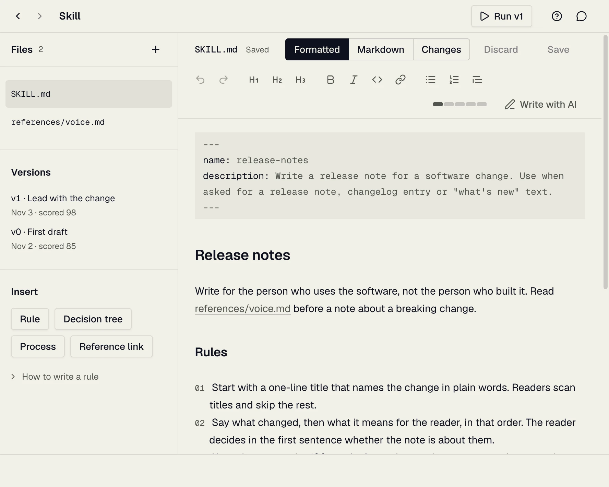

# How to use Skill Studio

Skill Studio shows you whether a skill makes an AI agent's answers better, and whether your last edit helped.

## How the loop works


Each step is a screen in the sidebar.

| Step | Screen | You |
| --- | --- | --- |
| 1 | Library | Pick a skill |
| 2 | Editor | Write its rules |
| 3 | Cases | Write tasks that test it |
| 4 | New run | Let agents do the tasks |
| 5 | Results | Read the judge's scores |
| 6 | Rate blind | Score the answers yourself |
| 7 | Agreement | See where you and the judge differ |
| 8 | Scoring | Adjust the judge |
| 9 | Editor | Fix the skill and run again |


The pictures show a sample skill, release-notes. Its scores are made up.

### Finding your way

- **Sidebar:** every screen of the open skill. A number counts what is there. A dot means unsaved work.
- **Next button** (top right): the step to do now.
- **Switch skill:** click the skill's name at the top of the sidebar, or press Cmd+K.
- **Back and forward:** the arrows at the top left.
- **Help:** the question mark at the top right explains the screen you are on.
- **Dotted underline:** click the word to see what it means.

On Windows and Linux, press Ctrl where this guide says Cmd.

## Start the app

You need:

1. **Skill Studio.** Download it from [Releases](https://github.com/milesroxas/skill-studio/releases).
2. **Claude Code or Cursor**, installed and signed in. These agents write the answers.
3. **A TypeSafe key** from [typesafe.ai](https://typesafe.ai), for Jev, the judge. Without it, answers get basic automatic checks only.

The first time you open the app, a welcome walks you through:

1. **See how it works:** the loop in six steps.
2. **Setup:** where your skills are, a model for the Assistant, and the Jev key. Already set? Click **Continue**. Not now? Click **Configure later**.

The last setup step's button opens the walkthrough. It reads **Start the walkthrough** once the Jev key is set, and **Configure later** before that.

To see the welcome again, click the question mark, then "How Skill Studio works".

To add the Jev key later, open **Settings** at the foot of the sidebar. Until you do, a "No Jev key" label at the top right takes you there. Settings also holds the theme and your other preferences.

## Take the walkthrough first

Take a finished skill once round the loop. Click **Start the walkthrough** in the welcome or the Library.

The walkthrough's skill, Thank-you note, writes short thank-you notes, so a run takes a minute or two. Every form is filled in for you. The Walkthrough box in the sidebar shows your step, and clicking it takes you there:

1. **Read the skill.** The Editor shows the rules the agent reads.
2. **Save it as v0.** Click "Save as v0" on Versions.
3. **Read the cases.** The three tasks, and the checks a good note passes.
4. **Run the skill.** Click "Start a run".
5. **Read the scores.** Results shows the judge's score for each case.
6. **Rate the notes.** Score each note before you see the judge's score.
7. **Check the judge.** Agreement sets your ratings against the judge's.
8. **See how a score adds up.** Scoring shows what each part of a score is worth.
9. **Tighten one rule.** "Keep the note to a reasonable length" is vague on purpose, so the notes come back too long. Click "Use the exact rule", then Save.
10. **Save your edit as v1.**
11. **Run it again.** Only the rule changed, so any difference is your edit.
12. **Compare the versions.** Read a note from each version side by side, and pick the better one.

A step that only asks you to look is done once you open its screen.

The walkthrough never changes what your agents do. To start over, open the skill menu at the top of the sidebar (Cmd+K) and choose **Restart walkthrough…**.

## 1. Open or create a skill


- **Open a skill:** click its name. Type in the search box to find one.
- **In progress:** the skills you have worked on.
- **Claude, Cursor, Codex:** install the skill for that agent, or remove it. Removing never deletes the skill.
- **"copy" on a button:** that agent has its own copy. Your edits here do not reach it.
- **Folder icon:** shows the skill's files on your computer.

To make a new skill:

1. Click **New skill**.
2. Pick a template. Leave "Add 3 sample cases to run against" ticked.
3. Type a name in lowercase, with dashes, like release-notes.
4. Write one line on what it is for. Agents read this to decide when to use it.
5. Pick a Place: "User (every project)", or one project.
6. Tick the agents that get it.
7. Click **Create skill**.

A skill missing from the list?

- Choose **All** beside the place filter.
- Click the round arrow beside New skill to look again.
- Open "Where skills are found" at the bottom, and add the folder its project is in.

## 2. Write the skill



- **Write** the skill's rules in the editor. Save with **Save** or Cmd+S.
- **Graded rules** (left) lists each rule exactly as the judge will check it.
- **Insert** adds a ready-made rule, process or decision tree at the cursor.
- **Formatted, Markdown, Changes:** read the page styled, as plain text, or as your unsaved changes.
- **Five bars** (before Write with AI, at the end of the toolbar) show the file's size. Amber: getting long. Red: too long.
- **Long background material** goes in a file of its own: click the plus beside Files.

Unsaved text is kept, even if you close the app. **Discard** throws it away.

### What the judge checks

The judge checks every bullet that starts a line and has four words or more. It skips:

- Numbered lists. Use them for steps.
- Sentences inside a paragraph.
- Indented bullets. They count as part of the bullet above.

### How to write a good rule

- **Say what to do.** "Lead with the change" beats "write clearly".
- **Give the reason.** The agent applies a rule better when it knows why.
- **Use numbers or absolutes.** "Under 120 words" or "never", not "reasonably".
- **Cut what changes nothing.** Every extra line takes attention from your rules.
- **One skill, one job.** A skill that covers everything is followed on nothing.

```
Vague:
- Try to keep notes reasonably short.

Exact, with its reason:
- Keep the note under 120 words. A note longer than one screen is not read.
```

### Write with AI

- **Connect a model** in Settings: an API key, or the Claude Code or Codex account you already use.
- **Ask:** click the small button in any text box, or **Write with AI** in the editor toolbar. Say what you want.
- **Nothing changes** until you click **Replace** or **Insert**.
- **Select text first** to rewrite only that part.
- **Assistant** (top right, or Cmd+J): a chat beside every screen. It reads your skill but never changes it.

### Save versions

- Open **Versions**, say what changed, and click **Save as v0**. Next time it is v1, then v2.
- Save your edits in the Editor first. A version holds saved files only.
- **Changes** compares two versions. **Restore** brings one back.
- **The bin** deletes a version and its runs. **Undo** brings them back.

## 3. Write cases

A case is one task for the agent: a request, plus checks a good answer passes.


1. Click the plus above the list. Or pick one under "Start from an example" and edit it.
2. **Title:** a short name.
3. **Prompt:** what a user would ask. Do not mention the skill: the test is whether the agent uses it on its own.
4. **Pictures** (optional): a screenshot or mock-up the prompt is about.
5. **A good answer:** one or two sentences on what it does.
6. **Checks:** one fact per row that a good answer makes true. Weight 2 counts twice as much as 1.
7. **Length** (optional): tick it to score the word count.
8. Click **Add case**.

Write at least three different cases before you trust a score.

## 4. Run the agents


1. **Skill version:** if the skill changed, type what changed.
2. **Cases:** tick the ones to run. One starts ticked. **Default case**, under the list, picks the one every run starts with: it moves to the top of the list and can still be unticked.
3. **Writers:** pick the agent and model. Add up to four to compare them.
4. **Samples per case:** use 2 or more. Agents answer a little differently each time.
5. **Skill:** "With skill", "Without skill" (the baseline to beat), or "Old skill" (an earlier version).
6. Leave **Grade when done** ticked.
7. Click **Start a run**.

The run works in the background. Its progress shows at the foot of the sidebar.

Runs cost money: each answer is an agent session, and the judge is paid per call.

## 5. Read the results


- **Top:** how much your latest version gained since the first, and against no skill at all.
- **Each row:** one run, with a score per case, the average, cost, time and flags.
- **Flag:** something the judge found wrong, such as a broken rule.
- **Click a score** to read that answer.
- **Click a run** to see each answer, and **Transcript** for the agent's steps.
- **Regrade** scores a run again, for example after you add checks.

A total is made of **layers**, such as "followed the rules" and "passed the checks". Read the layers: a total can hold steady while one layer drops.

The judge can be wrong. Step 6 checks it.

## 6. Rate answers blind


For each answer:

1. Read it. Open "The prompt and what the case checks" above it for context.
2. Rate it from 1 (unusable) to 5 (ready to use).
3. Mark each layer **Good** or **Bad**, where you have an opinion.
4. Add a note: what works, and what the skill should have done.
5. Click **Save and reveal**, or **Skip**.

Scores stay hidden until you save. Seeing the judge's score first would pull your rating toward it.

The answers you learn most from come first. After the reveal, you can save the answer as an anchor: a good or bad example the judge must get right.

### Compare two answers


- Pick two answers under **A** and **B**.
- Vote: **A is better**, **Tie** or **B is better**.
- **Ask Jev** has the judge vote on the same pair.
- Your votes and Jev's build two rankings lower on the screen.

Picking the better of two answers is easier, and more reliable, than scoring one.

### Read a transcript

**Transcript** shows every step the agent took. Read it when a score surprises you. Did the agent read the skill at all?

## 7. Check the judge against you


This screen fills in once you have rated some answers. Each layer lands in one of four boxes:


| Verdict | Means | Do |
| --- | --- | --- |
| change the skill | You both say the answers fall short | Fix the rule the flags name, then run again |
| tune the scoring | You and the judge disagree | Adjust that layer in Scoring |
| holding | You both say the answers are good | Nothing |

- **Your rating against the judge's total:** above 0.6, the judge ranks answers the way you do. It needs 3 ratings.
- **Pairs:** the picks where the judge chose the other answer.

## 8. Tune the scoring


Move a setting and every score updates at once. Nothing runs again, so it costs nothing.

- **Packs:** which sets of judge questions grade this skill.
- **Layer weights:** how much each layer counts.
- **Thresholds:** when a judge's answer counts as yes, as unsure, or as good.

Click **Save**. Change one setting at a time, then look at Agreement again.

## 9. Change the skill and run again

1. Read your notes and Agreement.
2. Fix what the bad answers have in common, not one answer.
3. Save a version on Versions, with what changed.
4. Run again, and compare the scores on Results.

To be sure an edit helped, run it against "Old skill" on the same cases, with 2 or more samples. If the scores differ less than one version's samples do, the edit made no clear difference.

## When something goes wrong

| Problem | Fix |
| --- | --- |
| "No Jev key" at the top right | Add the key in Settings |
| An agent says "(not set up)" in New run | Install that agent and sign in to it |
| A skill is missing from the Library | Choose All, click the round arrow, or add its folder under "Where skills are found" |
| A save is refused | The file changed outside the app. "Keep my draft", then Save, writes yours over it; "Use the file on disk" keeps the other |
| A rule is missing from Graded rules | Make it a bullet of four words or more, outside a numbered list |
| A score looks wrong | Read the transcript, then rate the answer blind |

Only test skills you trust. A skill can make the agent run code on your computer.
